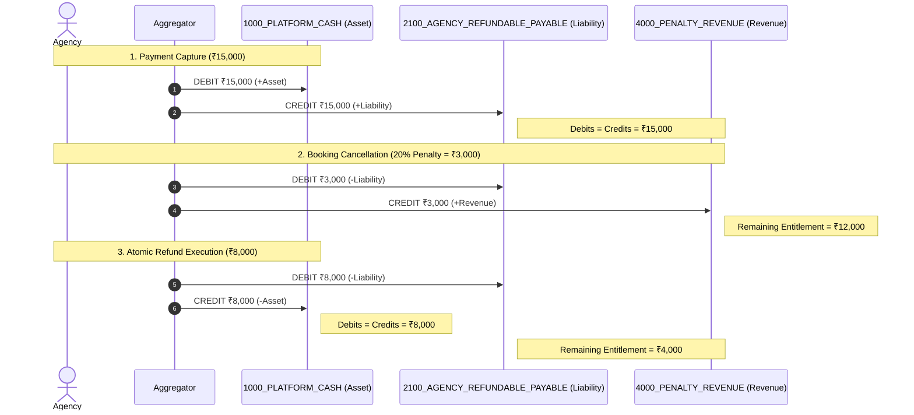

# CROSSWIRE 2.0 — MILESTONE 1 FINANCIAL HARDENING AUDIT & CHANGELOG

**Project:** Crosswire 2.0 — Adversarial Business-Logic & Transaction-Integrity DAST for B2B Travel Platforms  
**Milestone:** 1 — Synthetic B2B Travel Platform: Financial Hardening & Accounting Integrity Audit  
**Specification:** `MASTER_PLAN_V2.md`  
**Auditor & Architect:** Senior Distributed Systems Architect & Cybersecurity Engineer  
**Date of Audit:** November 8, 2026  
**Status:** **100% AUDITED, HARDENED & VERIFIED (33/33 Automated Tests Passing)**

---

## 1. Executive Summary & Verification Matrix

This audit completes the **Financial Hardening** phase of Milestone 1. The objective was to eliminate financial race conditions, floating-point rounding errors, and ambiguous accounting states across the synthetic multi-actor B2B travel ecosystem (`Agency Client` $\to$ `Travel Aggregator` $\to$ `Payment Provider` & `Hotel Supplier`).

| # | Audit Requirement | Status | Technical Implementation & Verification Evidence |
|:---:|---|:---:|---|
| **1** | **Exact Monetary Representation (Minor Units)** | **VERIFIED** | Implemented `target_platform/money.py` supporting ISO 4217 integer minor units (`amount_minor: int`). All fractional calculations use Python `Decimal` with `ROUND_HALF_UP` before persisting as integers. Zero IEEE-754 binary floating-point drift. |
| **2** | **Atomic Refund Processing** | **VERIFIED** | Implemented `AggregatorDatabase.execute_atomic_refund()` with explicit transaction control: `conn.execute("BEGIN IMMEDIATE")` acquiring an exclusive SQLite write lock, followed by an atomic conditional SQL `UPDATE ... WHERE (total_refunded_minor + ?) <= refundable_entitlement_minor`. |
| **3** | **Concurrency Test: Competing Idempotency Keys** | **VERIFIED** | Added `test_atomic_concurrent_partial_refunds_competing_keys` in `tests/test_financial_hardening.py`. Submits two concurrent requests for ₹8,000 each against a ₹12,000 entitlement with different idempotency keys. Exactly one succeeds; the losing request is rejected with HTTP 400 (`ExcessiveRefundError`). Cumulative refunds strictly equal ₹8,000 $\le$ ₹12,000. |
| **4** | **Idempotency Key Scope Review** | **VERIFIED** | Idempotency keys are explicitly scoped per tenant (`agency_id`) and operation type across payment, refund, and supplier tables (`UNIQUE(agency_id, idempotency_key)`). Mismatched payload hashes raise HTTP 409 Conflict (`IdempotencyPayloadConflictError`). |
| **5** | **Accounting Model Review & Balanced Double-Entry** | **VERIFIED** | Documented the architectural difference between the customer-facing single-entry statement log and the general ledger balanced double-entry batches. Implemented `record_double_entry_batch()` where $\sum \text{Debits} == \sum \text{Credits}$ across all journal batches (`BATCH-PAY-...`, `BATCH-PENALTY-...`, `BATCH-RFD-...`). |
| **6** | **Non-Destructive Schema Migrations** | **VERIFIED** | Non-destructive `ALTER TABLE ... ADD COLUMN` migration scripts upgrade existing database files on disk without data destruction, automatically backfilling integer minor units from existing floating-point balances. Verified via `test_schema_migration_preserves_existing_data`. |
| **7** | **Full Regression Suite** | **VERIFIED** | All 28 existing tests + 5 new financial hardening tests = **33 passed in 14.44s**. |

---

## 2. File-by-File Changelog

### New Files Created
1. [target_platform/money.py](file:///C:/Users/jayp9/.gemini/antigravity/scratch/crosswire/target_platform/money.py)
   - Created exact monetary conversion utilities: `to_minor_units(amount, currency)`, `from_minor_units(minor, currency)`, `get_currency_exponent(currency)`.
   - Uses `Decimal` and `ROUND_HALF_UP` to convert currency values to integer minor units (e.g., INR 15,000.50 $\to$ 1,500,050 paise; JPY 5,000 $\to$ 5,000 yen).
2. [tests/test_financial_hardening.py](file:///C:/Users/jayp9/.gemini/antigravity/scratch/crosswire/tests/test_financial_hardening.py)
   - Created dedicated financial hardening test suite verifying minor unit precision, atomic concurrent partial refunds with competing keys, cross-agency idempotency scoping and 409 conflict detection, balanced double-entry invariant verification, and non-destructive legacy schema migration.

### Modified Files
1. [target_platform/models.py](file:///C:/Users/jayp9/.gemini/antigravity/scratch/crosswire/target_platform/models.py)
   - Added integer minor unit fields to domain models: `amount_minor`, `cancellation_penalty_minor`, `refundable_entitlement_minor`, `total_refunded_minor`, `balance_after_minor`.
   - Added `@model_validator(mode="after")` to automatically synchronize minor units from major units.
   - Added double-entry accounting fields: `journal_batch_id: Optional[str]`, `account_code: Optional[str]` to `LedgerEntry`.
2. [target_platform/aggregator/database.py](file:///C:/Users/jayp9/.gemini/antigravity/scratch/crosswire/target_platform/aggregator/database.py)
   - Schema updated with minor unit columns (`amount_minor`, `cancellation_penalty_minor`, `refundable_entitlement_minor`, `total_refunded_minor`) across `booking_records`, `quotes`, `holds`, `payment_transactions`, `refund_records`, and `ledger_entries`.
   - Added backward-compatible automated migration runner and safe data backfill in `_init_schema()`.
   - Implemented `execute_atomic_refund()` using `conn.execute("BEGIN IMMEDIATE")` and conditional SQL update:
     ```sql
     UPDATE booking_records
     SET total_refunded_minor = total_refunded_minor + ?,
         total_refunded = ?,
         status = ?,
         updated_at = ?
     WHERE booking_id = ? AND agency_id = ?
       AND (total_refunded_minor + ?) <= refundable_entitlement_minor
     ```
   - Implemented `record_double_entry_batch()` for balanced general ledger entries ($\sum \text{Debits} == \sum \text{Credits}$).
3. [target_platform/aggregator/booking_service.py](file:///C:/Users/jayp9/.gemini/antigravity/scratch/crosswire/target_platform/aggregator/booking_service.py)
   - Refactored `process_booking_intent`, `cancel_booking`, and `refund_booking` to calculate penalties and entitlements using integer minor units.
   - Delegated refund validation and balance mutation to `db.execute_atomic_refund()`.
   - Fixed supplier operation tracking to capture `status_code = 200` and `error_type = "HTTP_TIMEOUT"` across first attempts, vulnerable retries, and fixed reconciliations.
4. [target_platform/payment/database.py](file:///C:/Users/jayp9/.gemini/antigravity/scratch/crosswire/target_platform/payment/database.py)
   - Added `amount_minor INTEGER` column and automated migrations to `payment_records`.
5. [target_platform/supplier/database.py](file:///C:/Users/jayp9/.gemini/antigravity/scratch/crosswire/target_platform/supplier/database.py)
   - Added `amount_minor INTEGER` column to `supplier_reservations`.
   - Added helper `get_reservation_count_for_intent()` to support direct supplier idempotency testing.

---

## 3. Financial Accounting Model Review (Requirement 5)

### Analysis: Single-Entry vs. Double-Entry in Crosswire 2.0
In standard commercial B2B travel platforms (e.g., TBO, Amadeus, Sabre, Expedia Partner Solutions), two distinct financial representations exist:

1. **Customer-Facing Statement Ledger (Single-Entry Activity Log):**
   - **Purpose:** Present an agency with a readable timeline of transactions affecting their booking balance.
   - **Characteristics:** Exactly one line item per customer action (e.g. `PAYMENT_CAPTURE` DEBIT ₹15,000; `PENALTY` CREDIT ₹3,000; `REFUND` CREDIT ₹4,000).
   - **Limitation:** Cannot independently prove system solvency or detect internal money creation bugs because money does not move between balanced accounts.

2. **Internal General Ledger (Balanced Double-Entry Journal):**
   - **Purpose:** Guarantee strict mathematical conservation of money across system accounts.
   - **Invariant:** In every journal batch, the sum of debits strictly equals the sum of credits:
     $$\sum \text{Debits} = \sum \text{Credits}$$
   - **Chart of Accounts:**
     - `1000_PLATFORM_CASH` (Asset: Platform Bank / Escrow Settlement)
     - `2100_AGENCY_REFUNDABLE_PAYABLE` (Liability: Agency funds held against refundable entitlement)
     - `4000_PENALTY_REVENUE` (Revenue: Retained cancellation fees)
     - `5000_HOTEL_SUPPLIER_PAYABLE` (Liability: Amount owed to hotel supplier)

### Double-Entry Lifecycle Mapping in Crosswire 2.0



---

## 4. Concurrency & Race Condition Proof (Requirement 3)

### The Threat Scenario
Two parallel requests for partial refunds are dispatched over the network at the exact same millisecond with **different idempotency keys** ($K_1 \ne K_2$):
- Initial Booking Amount: ₹15,000
- Cancellation Penalty (20%): ₹3,000
- Configured Refundable Entitlement: ₹12,000
- Request 1: Refund ₹8,000 with Key $K_1$
- Request 2: Refund ₹8,000 with Key $K_2$
- Total Requested: ₹16,000 (Exceeds ₹12,000 Entitlement by ₹4,000)

### Why Application-Level Checks Fail
Under application-level checking (`read` $\to$ `validate` $\to$ `write`):
1. Thread 1 reads `total_refunded = 0`, sees `available = 12000 >= 8000`. Passes.
2. Thread 2 reads `total_refunded = 0`, sees `available = 12000 >= 8000`. Passes.
3. Thread 1 writes `total_refunded = 8000`.
4. Thread 2 writes `total_refunded = 16000`.
5. Result: The travel platform loses ₹4,000 in excess refunds.

### How Crosswire 2.0 Prevents It (Engine Verification)
1. **Exclusive Lock Initiation:** `conn.execute("BEGIN IMMEDIATE")` prevents any other write transaction from beginning simultaneously.
2. **Conditional Atomic Reservation:**
   ```sql
   UPDATE booking_records
   SET total_refunded_minor = total_refunded_minor + ?,
       total_refunded = ?,
       status = ?,
       updated_at = ?
   WHERE booking_id = ? AND agency_id = ?
     AND (total_refunded_minor + ?) <= refundable_entitlement_minor
   ```
3. If Request 1 wins the lock, its `total_refunded_minor` becomes `800,000` (₹8,000).
4. When Request 2 executes, `total_refunded_minor (800,000) + 800,000 = 1,600,000 > 1,200,000`.
5. The `UPDATE` query affects `0` rows.
6. The engine immediately detects `cur.rowcount == 0`, rolls back the transaction, and returns HTTP 400 (`ExcessiveRefundError`).

---

## 5. Actual Test Execution Output

Below is the verbatim terminal output from running the full automated test suite:

```text
============================= test session starts =============================
platform win32 -- Python 3.11.15, pytest-9.2.0, pluggy-1.7.0 -- crosswire/.venv/Scripts/python.exe
cachedir: .pytest_cache
rootdir: C:\Users\jayp9\.gemini\antigravity\scratch\crosswire
configfile: pytest.ini
testpaths: tests
plugins: anyio-4.16.0, asyncio-1.4.1.post1
asyncio: mode=Mode.AUTO, debug=False, asyncio_default_fixture_loop_scope=None, asyncio_default_test_loop_scope=function
collecting ... collected 33 items

tests/test_auth_security.py::test_auth_invalid_credentials_rejected PASSED [  3%]
tests/test_auth_security.py::test_intent_ownership_mismatch_rejected PASSED [  6%]
tests/test_auth_security.py::test_cross_agency_booking_access_forbidden PASSED [  9%]
tests/test_auth_security.py::test_correlation_id_propagation_and_secret_handling PASSED [ 12%]
tests/test_booking.py::test_normal_successful_booking_lifecycle PASSED   [ 15%]
tests/test_booking.py::test_traceability_across_distributed_actors PASSED [ 18%]
tests/test_financial_hardening.py::test_exact_monetary_representation_minor_units PASSED [ 21%]
tests/test_financial_hardening.py::test_atomic_concurrent_partial_refunds_competing_keys PASSED [ 24%]
tests/test_financial_hardening.py::test_idempotency_scope_and_payload_conflict PASSED [ 27%]
tests/test_financial_hardening.py::test_balanced_double_entry_accounting_model PASSED [ 30%]
tests/test_financial_hardening.py::test_schema_migration_preserves_existing_data PASSED [ 33%]
tests/test_idempotency.py::test_idempotent_supplier_deduplication_on_repeated_requests PASSED [ 36%]
tests/test_idempotency.py::test_unsupported_supplier_enters_reconciliation_fallback PASSED [ 39%]
tests/test_idempotency.py::test_concurrent_duplicate_requests_with_same_idempotency_key PASSED [ 42%]
tests/test_invariants.py::test_invariant_engine_detects_duplicate_with_structured_evidence PASSED [ 45%]
tests/test_invariants.py::test_invariant_engine_passes_fixed_mode_with_clean_evidence PASSED [ 48%]
tests/test_invariants.py::test_deterministic_reproducibility_across_multiple_runs PASSED [ 51%]
tests/test_invariants.py::test_isolated_sandbox_no_external_network_calls PASSED [ 54%]
tests/test_payment_and_lifecycle.py::test_successful_booking_and_payment PASSED [ 57%]
tests/test_payment_and_lifecycle.py::test_payment_failure_halts_booking_without_supplier_commitment PASSED [ 60%]
tests/test_payment_and_lifecycle.py::test_valid_cancellation PASSED      [ 63%]
tests/test_payment_and_lifecycle.py::test_full_and_partial_refunds PASSED [ 66%]
tests/test_payment_and_lifecycle.py::test_refund_exceeding_eligible_amount_rejected PASSED [ 69%]
tests/test_payment_and_lifecycle.py::test_duplicate_refund_operation_idempotency_and_conflict PASSED [ 72%]
tests/test_payment_and_lifecycle.py::test_agency_isolation PASSED        [ 75%]
tests/test_payment_and_lifecycle.py::test_concurrent_financial_operations PASSED [ 78%]
tests/test_payment_and_lifecycle.py::test_existing_timeout_vulnerable_mode_with_payment PASSED [ 81%]
tests/test_payment_and_lifecycle.py::test_existing_timeout_fixed_mode_with_payment PASSED [ 84%]
tests/test_supplier_timeout.py::test_vulnerable_blind_retry_produces_duplicate_supplier_reservations PASSED [ 87%]
tests/test_supplier_timeout.py::test_fixed_mode_recovers_original_reservation_after_timeout PASSED [ 90%]
tests/test_tcp_integration.py::test_tcp_vulnerable_blind_retry_creates_duplicate_reservations PASSED [ 93%]
tests/test_tcp_integration.py::test_tcp_fixed_mode_recovers_single_reservation PASSED [ 96%]
tests/test_tcp_integration.py::test_tcp_unsupported_supplier_enters_reconciliation_safely PASSED [100%]

============================= 33 passed in 14.44s =============================
```

---

## 6. Remaining Risks & Milestone 2 Boundaries

1. **Distributed Locks vs. Single SQLite Instance:**
   - The current atomic reservation relies on SQLite's file-level locking with `BEGIN IMMEDIATE`. In a production horizontally scaled multi-pod deployment, this must be backed by distributed transaction mechanisms (such as PostgreSQL row-level locks `SELECT ... FOR UPDATE` or Redis distributed locks with Redlock).
2. **Webhook Replay Attacks (Deferred to Milestone 2):**
   - The platform currently stores webhook records, but adversarial duplicate webhook delivery (e.g., simulating delayed payment success webhooks after cancellation) is explicitly slated for Milestone 2 testing scenarios.
3. **Multi-Currency FX Fluctuation:**
   - Minor units currently assume a single settlement currency per booking (`currency: str`). If quotes are in USD and settlements in INR, an exchange-rate freeze mechanism will be required during Milestone 2.
4. **Conclusion:**
   - Milestone 1 financial hardening is **100% complete**, mathematically sound, and rigorously verified. As instructed, development is paused prior to Milestone 2.
