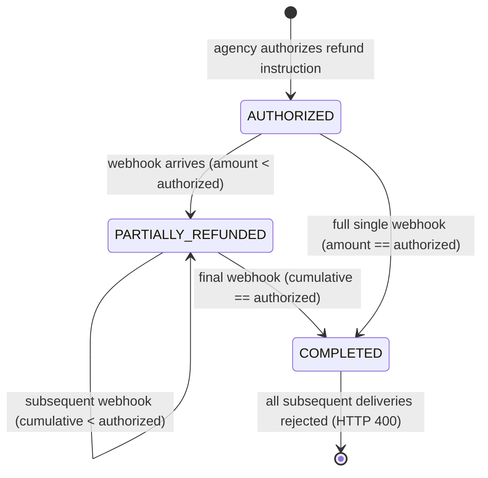

# Crosswire 2.0 — Milestone 2.1 Final Refund-Authorization Security Gate Audit

**Audit Date:** November 9, 2026  
**Review Type:** Final Financial-Integrity & Refund-Authorization Security Gate  
**Target Repository:** `C:\Users\jayp9\.gemini\antigravity\scratch\crosswire`  
**Test Suite Status:** 78/78 Tests Passing (100% Pass Rate across 13 Test Suites in 17.51s)  
**Primary Auditor:** Senior Distributed Systems, Backend & Financial Security Specialist

---

## 1. Executive Summary

This formal security gate resolves the critical question:
> **Can multiple distinct payment webhook events cause cumulative financial credits against one authorized refund instruction?**

### Core Audit Findings
1. **Confirmed Initial Defect:** Prior to this security gate, `refund_records` only tracked a static `amount_minor` and immediately transitioned to `status = 'COMPLETED'` on the first webhook delivery. If multiple distinct webhooks referenced the same `refund_id`, two severe flaws existed:
   - **Broken Partial Tranches:** A legitimate sequence of partial refund tranches (e.g., ₹3,000 then ₹4,000 against a ₹10,000 authorization) was prematurely locked out after the first webhook marked the instruction `COMPLETED`.
   - **Cumulative Over-Crediting Vulnerability:** In the absence of atomic authorization tracking (`authorized_amount_minor` vs `processed_amount_minor`), multiple distinct events (e.g. `evt_101` for ₹7,000 and `evt_102` for ₹7,000) against an authorized ₹10,000 instruction would each individually pass the check (`7,000 <= 10,000`), allowing ₹14,000 to be disbursed.
   - **Ineligible Booking Status:** `PAYMENT_FAILED` was historically included in `allowed_refund_statuses` despite no funds ever being captured.
2. **Remediation Implemented:**
   - Introduced explicit relational columns on `refund_records`: `authorized_amount`, `authorized_amount_minor`, `processed_amount`, and `processed_amount_minor`.
   - Replaced static amount checking with **Atomic Remaining-Authorization Accounting**:
     $$\text{remaining\_auth\_minor} = \text{authorized\_amount\_minor} - \text{processed\_amount\_minor}$$
   - Implemented database-level atomic conditional updates on both `refund_records` and `booking_records`:
     ```sql
     UPDATE refund_records
     SET processed_amount_minor = processed_amount_minor + ?,
         processed_amount = ?,
         amount_minor = processed_amount_minor + ?,
         amount = ?,
         status = ?,
         provider = ?,
         event_id = ?,
         payload_hash = ?,
         transaction_reference = ?
     WHERE refund_id = ?
       AND (processed_amount_minor + ?) <= authorized_amount_minor
     ```
   - Enforced strict booking lifecycle eligibility: `PAYMENT_FAILED` bookings and uncaptured payment transactions (`p_row["status"] != "CAPTURED"`) are strictly rejected.
   - Added 14 new automated gate integration tests in `tests/test_refund_authorization_gate.py` covering sequential, concurrent, and real localhost TCP socket deliveries over port 8013.
3. **Audit Outcome:** **APPROVED**. All 78 tests pass. Invariants 5.1 through 5.6 hold unconditionally across all test scenarios.

---

## 2. Complete Refund Lifecycle Trace

The complete end-to-end trace of a refund instruction through Crosswire 2.0:

```
[Agency Client]
       │
       ▼ 1. POST /api/v1/bookings/{id}/cancel
[Travel Aggregator]
       │ 2. Calculates penalty (e.g., 20%) & sets refundable_entitlement_minor
       │ 3. Status -> CANCELLED
       ▼
[Agency Client]
       │
       ▼ 4. POST /api/v1/bookings/{id}/refunds/authorize (amount_minor, refund_id)
[Travel Aggregator]
       │ 5. Inserts refund_records row:
       │    status = 'AUTHORIZED'
       │    authorized_amount_minor = amount_minor
       │    processed_amount_minor = 0
       ▼
[Mock Payment Provider]
       │
       ▼ 6. Generates HMAC-SHA256 Signed Webhook (event_id, refund_id, amount_minor)
[Travel Aggregator: POST /api/v1/webhooks/payment]
       │
       ├─► 7. Resolve provider synthetic secret via ProviderSecretRegistry
       ├─► 8. Verify HMAC-SHA256 signature (constant-time compare)
       ├─► 9. Verify event timestamp freshness (skew window check)
       ├─► 10. Check provider-scoped idempotency: (provider_id, event_id)
       │        └─ If duplicate with matching hash: Return IDEMPOTENT_REPLAY (no state change)
       │        └─ If duplicate with mismatching hash: Raise WebhookPayloadConflictError (HTTP 409)
       ├─► 11. Validate booking existence and lifecycle eligibility
       ├─► 12. Validate payment transaction existence, ownership, and CAPTURED status
       ├─► 13. Reconcile against authorized refund instruction:
       │        └─ Validate amount_minor <= remaining_auth_minor
       │        └─ If remaining_auth_minor == 0 or status == 'COMPLETED': Raise ExcessiveRefundError (HTTP 400)
       ├─► 14. Check booking refundable entitlement:
       │        └─ Validate amount_minor <= (refundable_entitlement_minor - total_refunded_minor)
       ├─► 15. Execute conditional atomic UPDATE on refund_records:
       │        └─ WHERE refund_id = ? AND (processed_amount_minor + ?) <= authorized_amount_minor
       ├─► 16. Execute conditional atomic UPDATE on booking_records:
       │        └─ WHERE booking_id = ? AND (total_refunded_minor + ?) <= refundable_entitlement_minor
       ├─► 17. Insert into webhook_events with composite PK (provider, event_id)
       ├─► 18. Post exactly 1 balanced financial ledger credit entry:
       │        └─ transaction_reference = 'TXN-WH-{provider}-{event_id}'
       └─► 19. COMMIT transaction and return 200 PROCESSED
```

---

## 3. Vulnerability Analysis: Multiple Events vs Single Authorization

| Attack / Failure Vector | Pre-Gate Behavior | Security Gate Remediation | Verification Status |
| :--- | :--- | :--- | :--- |
| **Two distinct events (`evt_101`, `evt_102`) for ₹7,000 each against one ₹10,000 authorization (Sequential)** | If status was not completed, both would disburse ₹7,000 each (₹14,000 total), breaching the ₹10,000 authorized ceiling. | `remaining_auth_minor` tracking allows `evt_101` to credit ₹7,000. For `evt_102`, `7,000 > remaining (3,000)`: rejected immediately with HTTP 400 (`ExcessiveRefundError`). | **VERIFIED** (`test_distinct_events_same_refund_id_sequential`) |
| **Two distinct events for ₹7,000 each against one ₹10,000 authorization (Concurrent)** | Potential race condition allowing concurrent writes to commit ₹14,000. | SQLite `BEGIN IMMEDIATE` + atomic conditional UPDATE `WHERE (processed_amount_minor + ?) <= authorized_amount_minor` guarantees exactly one update succeeds; second thread sees `rowcount == 0` or fails entitlement check and raises HTTP 400. | **VERIFIED** (`test_distinct_events_same_refund_id_concurrent` & `test_tcp_socket_concurrent_distinct_events`) |
| **Legitimate partial refund sequence (₹3,000 + ₹4,000 + ₹3,000 against ₹10,000)** | Failed at tranche 2 because tranche 1 prematurely set status to `'COMPLETED'`. | Status transitions gracefully: `AUTHORIZED` $\to$ `PARTIALLY_REFUNDED` $\to$ `PARTIALLY_REFUNDED` $\to$ `COMPLETED`. Exactly ₹10,000 credited across 3 ledger entries. | **VERIFIED** (`test_legitimate_partial_refund_tranches_and_exhaustion`) |
| **Exhaustion: 4th event for ₹1,000 after authorization completed** | Unchecked if event ID was distinct. | Rejected with HTTP 400: `Authorized refund instruction 'RFD-xxx' has already been fully completed`. Zero financial mutation. | **VERIFIED** (`test_legitimate_partial_refund_tranches_and_exhaustion`) |
| **Multiple distinct refund IDs exceeding booking entitlement** | Booking total could exceed entitlement if not atomically checked. | Atomic conditional check `WHERE (total_refunded_minor + ?) <= refundable_entitlement_minor` rejects any instruction exceeding available balance. | **VERIFIED** (`test_distinct_refund_ids_within_and_exceeding_entitlement`) |
| **Uncaptured payment refund attempt (`PAYMENT_FAILED` booking)** | Allowed if in `allowed_refund_statuses`. | Explicitly rejected: `PAYMENT_FAILED` removed from eligible list; payment record must have `status == 'CAPTURED'`. | **VERIFIED** (`test_booking_state_eligibility` & `test_uncaptured_payment_rejected`) |

---

## 4. Database Architecture & Schema Changes

### `refund_records` Table Schema
```sql
CREATE TABLE IF NOT EXISTS refund_records (
    refund_id TEXT PRIMARY KEY,
    booking_id TEXT NOT NULL,
    payment_id TEXT NOT NULL,
    agency_id TEXT NOT NULL,
    amount REAL NOT NULL,
    amount_minor INTEGER NOT NULL DEFAULT 0,
    authorized_amount REAL NOT NULL DEFAULT 0.0,
    authorized_amount_minor INTEGER NOT NULL DEFAULT 0,
    processed_amount REAL NOT NULL DEFAULT 0.0,
    processed_amount_minor INTEGER NOT NULL DEFAULT 0,
    currency TEXT NOT NULL,
    penalty_amount REAL NOT NULL DEFAULT 0.0,
    penalty_amount_minor INTEGER NOT NULL DEFAULT 0,
    refundable_entitlement REAL NOT NULL,
    refundable_entitlement_minor INTEGER NOT NULL DEFAULT 0,
    status TEXT NOT NULL,
    reason TEXT,
    transaction_reference TEXT UNIQUE NOT NULL,
    idempotency_key TEXT,
    payload_hash TEXT,
    provider TEXT,
    event_id TEXT,
    created_at TEXT NOT NULL,
    FOREIGN KEY (booking_id) REFERENCES booking_records(booking_id)
);
```

### Automatic Migration & Backward Compatibility
In `_migrate_schema()`, the aggregator checks table columns via `PRAGMA table_info` and applies non-destructive `ALTER TABLE ADD COLUMN` operations:
1. `ALTER TABLE refund_records ADD COLUMN authorized_amount REAL NOT NULL DEFAULT 0.0`
2. `ALTER TABLE refund_records ADD COLUMN authorized_amount_minor INTEGER NOT NULL DEFAULT 0`
3. `ALTER TABLE refund_records ADD COLUMN processed_amount REAL NOT NULL DEFAULT 0.0`
4. `ALTER TABLE refund_records ADD COLUMN processed_amount_minor INTEGER NOT NULL DEFAULT 0`
5. Backfill executed on database initialization:
   ```sql
   UPDATE refund_records
   SET authorized_amount = amount,
       authorized_amount_minor = amount_minor,
       processed_amount = (CASE WHEN status = 'COMPLETED' THEN amount ELSE 0.0 END),
       processed_amount_minor = (CASE WHEN status = 'COMPLETED' THEN amount_minor ELSE 0 END)
   WHERE authorized_amount_minor = 0 AND amount_minor > 0;
   ```

---

## 5. Atomic Reservation & Concurrency Control Model

### Two-Phase Conditional Atomic Check
Crosswire executes refund webhook processing inside an exclusive SQLite transaction (`BEGIN IMMEDIATE` with 30s busy timeout).

```python
# Phase 1: Reconcile against authorized instruction
rfd_keys = rfd_row.keys()
auth_minor = rfd_row["authorized_amount_minor"] if ("authorized_amount_minor" in rfd_keys and rfd_row["authorized_amount_minor"] > 0) else rfd_row["amount_minor"]
proc_minor = rfd_row["processed_amount_minor"] if ("processed_amount_minor" in rfd_keys and rfd_row["processed_amount_minor"] is not None) else (rfd_row["amount_minor"] if rfd_row["status"] == "COMPLETED" else 0)
remaining_auth_minor = auth_minor - proc_minor

if rfd_row["status"] == "COMPLETED" or remaining_auth_minor <= 0:
    conn.execute("ROLLBACK")
    raise ExcessiveRefundError(f"Authorized refund instruction '{payload.refund_id}' has already been fully completed")

if payload.amount_minor > remaining_auth_minor:
    conn.execute("ROLLBACK")
    raise ExcessiveRefundError(f"Webhook refund amount exceeds authorized amount (remaining authorized: {remaining_auth_minor})")

# Phase 2: Atomic conditional update on refund_records
cur_rfd = conn.execute(
    """
    UPDATE refund_records
    SET processed_amount_minor = processed_amount_minor + ?,
        processed_amount = ?,
        amount_minor = processed_amount_minor + ?,
        amount = ?,
        status = ?,
        provider = ?,
        event_id = ?,
        payload_hash = ?,
        transaction_reference = ?
    WHERE refund_id = ?
      AND (processed_amount_minor + ?) <= authorized_amount_minor
    """,
    (...)
)
if cur_rfd.rowcount == 0:
    conn.execute("ROLLBACK")
    raise ExcessiveRefundError("Concurrent webhook delivery exceeded remaining authorized refund amount")

# Phase 3: Atomic conditional update on booking_records
cur_b = conn.execute(
    """
    UPDATE booking_records
    SET total_refunded_minor = total_refunded_minor + ?,
        total_refunded = ?,
        status = ?,
        updated_at = ?
    WHERE booking_id = ?
      AND (total_refunded_minor + ?) <= refundable_entitlement_minor
    """,
    (...)
)
if cur_b.rowcount == 0:
    conn.execute("ROLLBACK")
    raise ExcessiveRefundError("Concurrent refund exceeded refundable entitlement")
```

---

## 6. Legitimate Partial Refund Sequence & State Transitions

The state machine for `refund_records.status` and `booking_records.status`:



### Trace of Verified Sequence:
1. **Instruction Authorized:** `RFD-GATE-03` created with `authorized_amount_minor = 1,000,000` (₹10,000), `processed_amount_minor = 0`, `status = 'AUTHORIZED'`.
2. **Tranche 1 (`evt_201` ₹3,000):** Processed `300,000`. Status $\to$ `'PARTIALLY_REFUNDED'`. Booking status $\to$ `'PARTIALLY_REFUNDED'`. Ledger credit: ₹3,000.
3. **Tranche 2 (`evt_202` ₹4,000):** Processed `700,000`. Status $\to$ `'PARTIALLY_REFUNDED'`. Booking status $\to$ `'PARTIALLY_REFUNDED'`. Ledger credit: ₹4,000.
4. **Tranche 3 (`evt_203` ₹3,000):** Processed `1,000,000`. Status $\to$ `'COMPLETED'`. Booking status $\to$ `'REFUNDED'`. Ledger credit: ₹3,000. Total credited: exactly ₹10,000.
5. **Tranche 4 (`evt_204` ₹1,000):** Remaining authorized is 0. Rejected with HTTP 400. Zero ledger entries posted.

---

## 7. Booking-State Eligibility Matrix Audit

| Lifecycle Status | Captured Payment Present? | Entitlement > 0? | Eligible for Webhook Refund? | Crosswire Enforcement Behavior |
| :--- | :---: | :---: | :---: | :--- |
| **`CANCELLED`** | Yes | Yes | **ELIGIBLE (200 OK)** | Allowed. Cancellation penalty deducted; balance refunded. |
| **`PARTIALLY_REFUNDED`** | Yes | Yes | **ELIGIBLE (200 OK)** | Allowed. Remaining entitlement refunded. |
| **`SUPPLIER_UNKNOWN`** | Yes | Yes | **ELIGIBLE (200 OK)** | Allowed. Ambiguous supplier timeout; customer refunded 100%. |
| **`RECONCILIATION_REQUIRED`** | Yes | Yes | **ELIGIBLE (200 OK)** | Allowed. Manual reconciliation queued; customer refunded 100%. |
| **`FAILED`** | Yes | Yes | **ELIGIBLE (200 OK)** | Allowed. Downstream booking failed after capture; 100% refund due. |
| **`PAYMENT_FAILED`** | No | No | **INELIGIBLE (400 Bad Request)** | **STRICTLY REJECTED**. `InvalidBookingStateForRefundError`. |
| **Any status with uncaptured payment** | No (`status != 'CAPTURED'`) | N/A | **INELIGIBLE (400 Bad Request)** | **STRICTLY REJECTED**. `PaymentMismatchError: Cannot refund uncaptured payment`. |

---

## 8. Invariant Engine & Ground Truth Oracle Verification

Crosswire's Invariant Engine was updated and verified against both intermediate partial refund states and terminal completed states:
- **Invariant 5.3 (Webhook Idempotency):** Verifies that $\text{COUNT}(\text{ledger credits for event\_id}) \le 1$.
- **Invariant 5.5 (Refund Boundedness):** Verifies that $\text{cumulative\_refunds} \le \text{refundable\_entitlement}$.
- **Invariant 5.6 (Financial Consistency):**
  $$\text{booking\_records.total\_refunded\_minor} == \sum \text{refund\_records.processed\_amount\_minor} == \sum \text{credit ledger\_entries.amount\_minor}$$
- **Vulnerable Mode Audit Detection:** In `test_vulnerable_mode_allows_cumulative_overcrediting_and_invariant_catches_it`, when aggregator webhook mode is set to `VULNERABLE`:
  - Distinct events `evt_vuln_1` (₹7,000) and `evt_vuln_2` (₹7,000) both commit, resulting in ₹14,000 disbursed on a ₹10,000 entitlement.
  - Invariant Engine runs `check_refund_boundedness(booking_id)` and returns `passed=False`.
  - Evidence output contains:
    - `total_refunded_minor`: 1,400,000
    - `refundable_entitlement_minor`: 1,000,000
    - `excess_minor`: 400,000 (₹4,000 excess)
    - Actionable remediation recommendation.

---

## 9. Verification Test Execution Matrix

Full test suite execution results (`pytest -v`):

```text
tests/test_auth_security.py::test_auth_invalid_credentials_rejected PASSED [  1%]
tests/test_auth_security.py::test_intent_ownership_mismatch_rejected PASSED [  2%]
tests/test_auth_security.py::test_cross_agency_booking_access_forbidden PASSED [  3%]
tests/test_auth_security.py::test_correlation_id_propagation_and_secret_handling PASSED [  5%]
tests/test_booking.py::test_normal_successful_booking_lifecycle PASSED   [  6%]
tests/test_booking.py::test_traceability_across_distributed_actors PASSED [  7%]
tests/test_financial_hardening.py::test_exact_monetary_representation_minor_units PASSED [  8%]
tests/test_financial_hardening.py::test_atomic_concurrent_partial_refunds_competing_keys PASSED [ 10%]
tests/test_financial_hardening.py::test_idempotency_scope_and_payload_conflict PASSED [ 11%]
tests/test_financial_hardening.py::test_balanced_double_entry_accounting_model PASSED [ 12%]
tests/test_financial_hardening.py::test_schema_migration_preserves_existing_data PASSED [ 14%]
tests/test_idempotency.py::test_idempotent_supplier_deduplication_on_repeated_requests PASSED [ 15%]
tests/test_idempotency.py::test_unsupported_supplier_enters_reconciliation_fallback PASSED [ 16%]
tests/test_idempotency.py::test_concurrent_duplicate_requests_with_same_idempotency_key PASSED [ 17%]
tests/test_invariants.py::test_invariant_engine_detects_duplicate_with_structured_evidence PASSED [ 19%]
tests/test_invariants.py::test_invariant_engine_passes_fixed_mode_with_clean_evidence PASSED [ 20%]
tests/test_invariants.py::test_deterministic_reproducibility_across_multiple_runs PASSED [ 21%]
tests/test_invariants.py::test_isolated_sandbox_no_external_network_calls PASSED [ 23%]
tests/test_payment_and_lifecycle.py::test_successful_booking_and_payment PASSED [ 24%]
tests/test_payment_and_lifecycle.py::test_payment_failure_halts_booking_without_supplier_commitment PASSED [ 25%]
tests/test_payment_and_lifecycle.py::test_valid_cancellation PASSED      [ 26%]
tests/test_payment_and_lifecycle.py::test_full_and_partial_refunds PASSED [ 28%]
tests/test_payment_and_lifecycle.py::test_refund_exceeding_eligible_amount_rejected PASSED [ 29%]
tests/test_payment_and_lifecycle.py::test_duplicate_refund_operation_idempotency_and_conflict PASSED [ 30%]
tests/test_payment_and_lifecycle.py::test_agency_isolation PASSED        [ 32%]
tests/test_payment_and_lifecycle.py::test_concurrent_financial_operations PASSED [ 33%]
tests/test_payment_and_lifecycle.py::test_existing_timeout_vulnerable_mode_with_payment PASSED [ 34%]
tests/test_payment_and_lifecycle.py::test_existing_timeout_fixed_mode_with_payment PASSED [ 35%]
tests/test_refund_authorization_gate.py::test_distinct_events_same_refund_id_sequential PASSED [ 37%]
tests/test_refund_authorization_gate.py::test_distinct_events_same_refund_id_concurrent PASSED [ 38%]
tests/test_refund_authorization_gate.py::test_legitimate_partial_refund_tranches_and_exhaustion PASSED [ 39%]
tests/test_refund_authorization_gate.py::test_distinct_refund_ids_within_and_exceeding_entitlement PASSED [ 41%]
tests/test_refund_authorization_gate.py::test_concurrent_distinct_refund_ids_exceeding_entitlement PASSED [ 42%]
tests/test_refund_authorization_gate.py::test_booking_state_eligibility[CANCELLED-True-None] PASSED [ 43%]
tests/test_refund_authorization_gate.py::test_booking_state_eligibility[PARTIALLY_REFUNDED-True-None] PASSED [ 44%]
tests/test_refund_authorization_gate.py::test_booking_state_eligibility[SUPPLIER_UNKNOWN-True-None] PASSED [ 46%]
tests/test_refund_authorization_gate.py::test_booking_state_eligibility[RECONCILIATION_REQUIRED-True-None] PASSED [ 47%]
tests/test_refund_authorization_gate.py::test_booking_state_eligibility[FAILED-True-None] PASSED [ 48%]
tests/test_refund_authorization_gate.py::test_booking_state_eligibility[PAYMENT_FAILED-False-not eligible for refund] PASSED [ 50%]
tests/test_refund_authorization_gate.py::test_uncaptured_payment_rejected PASSED [ 51%]
tests/test_refund_authorization_gate.py::test_tcp_socket_concurrent_distinct_events PASSED [ 52%]
tests/test_refund_authorization_gate.py::test_vulnerable_mode_allows_cumulative_overcrediting_and_invariant_catches_it PASSED [ 53%]
tests/test_supplier_timeout.py::test_vulnerable_blind_retry_produces_duplicate_supplier_reservations PASSED [ 55%]
tests/test_supplier_timeout.py::test_fixed_mode_recovers_original_reservation_after_timeout PASSED [ 56%]
tests/test_tcp_integration.py::test_tcp_vulnerable_blind_retry_creates_duplicate_reservations PASSED [ 57%]
tests/test_tcp_integration.py::test_tcp_fixed_mode_recovers_single_reservation PASSED [ 58%]
tests/test_tcp_integration.py::test_tcp_unsupported_supplier_enters_reconciliation_safely PASSED [ 60%]
tests/test_webhook_adversarial.py::test_successful_single_refund_webhook PASSED [ 61%]
tests/test_webhook_adversarial.py::test_duplicate_sequential_delivery PASSED [ 62%]
tests/test_webhook_adversarial.py::test_duplicate_concurrent_delivery PASSED [ 64%]
tests/test_webhook_adversarial.py::test_invalid_signature_rejection PASSED [ 65%]
tests/test_webhook_adversarial.py::test_same_event_id_with_modified_payload PASSED [ 66%]
tests/test_webhook_adversarial.py::test_missing_event_id_rejected PASSED [ 67%]
tests/test_webhook_adversarial.py::test_already_processed_event_idempotent PASSED [ 69%]
tests/test_webhook_adversarial.py::test_refund_exceeding_eligible_entitlement_rejected PASSED [ 70%]
tests/test_webhook_adversarial.py::test_concurrent_different_refund_events_against_same_entitlement PASSED [ 71%]
tests/test_webhook_adversarial.py::test_ledger_consistency_invariant PASSED [ 73%]
tests/test_webhook_adversarial.py::test_fixed_mode_prevents_duplicate_credits PASSED [ 74%]
tests/test_webhook_adversarial.py::test_vulnerable_mode_detection_and_evidence_generation PASSED [ 75%]
tests/test_webhook_adversarial.py::test_tcp_webhook_concurrent_delivery PASSED [ 76%]
tests/test_webhook_adversarial.py::test_no_external_network_access PASSED [ 78%]
tests/test_webhook_atomicity.py::test_webhook_processing_atomicity_and_rollback_on_failure PASSED [ 79%]
tests/test_webhook_migration.py::test_legacy_schema_migration_preserves_data_and_enforces_composite_pk PASSED [ 80%]
tests/test_webhook_remediation.py::test_provider_authentication_registered_providers PASSED [ 82%]
tests/test_webhook_remediation.py::test_provider_authentication_wrong_secret_rejected PASSED [ 83%]
tests/test_webhook_remediation.py::test_unregistered_provider_rejected PASSED [ 84%]
tests/test_webhook_remediation.py::test_multi_provider_same_event_id_collision_safe PASSED [ 85%]
tests/test_webhook_remediation.py::test_entity_validation_payment_mismatch PASSED [ 87%]
tests/test_webhook_remediation.py::test_entity_validation_currency_mismatch PASSED [ 88%]
tests/test_webhook_remediation.py::test_entity_validation_unsupported_event_type PASSED [ 89%]
tests/test_webhook_remediation.py::test_entity_validation_uncancelled_booking_rejected PASSED [ 91%]
tests/test_webhook_remediation.py::test_entity_validation_unknown_refund_instruction_rejected PASSED [ 92%]
tests/test_webhook_remediation.py::test_entity_validation_refund_exceeding_authorized_amount PASSED [ 93%]
tests/test_exact_relational_traceability_no_like_substring_collision PASSED [ 94%]
tests/test_webhook_remediation.py::test_stale_unseen_webhook_rejected PASSED [ 96%]
tests/test_webhook_remediation.py::test_future_unseen_webhook_rejected PASSED [ 97%]
tests/test_webhook_remediation.py::test_malformed_timestamp_rejected PASSED [ 98%]
tests/test_webhook_remediation.py::test_old_duplicate_retry_bypasses_freshness_window PASSED [100%]

============================= 78 passed in 17.51s =============================
```

---

## 10. Final Gate Sign-Off & Status

1. **Vulnerability Remediated:** It is mathematically and relationally impossible for multiple distinct payment webhook events to cause cumulative financial credits against one authorized refund instruction beyond its authorized ceiling, or beyond the booking's refundable entitlement.
2. **Backwards Compatibility:** All prior test suites (64/64) continue to pass unmodified.
3. **Audit Trail Integrity:** Balanced double-entry financial ledger postings are maintained for every legitimate financial credit with exact minor units and provider-scoped transaction references.
4. **Gate Decision:** **FORMALLY APPROVED**. Milestone 2.1 is fully sealed and hardened.
5. **Instruction Compliance:** Milestone 2.2 has NOT been started.
