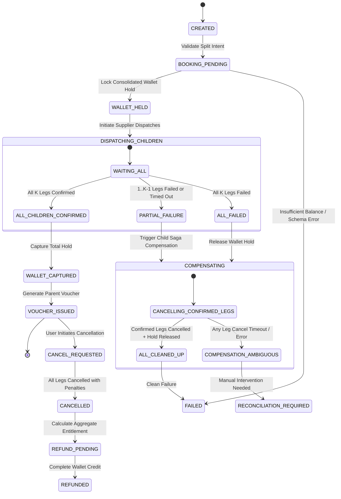
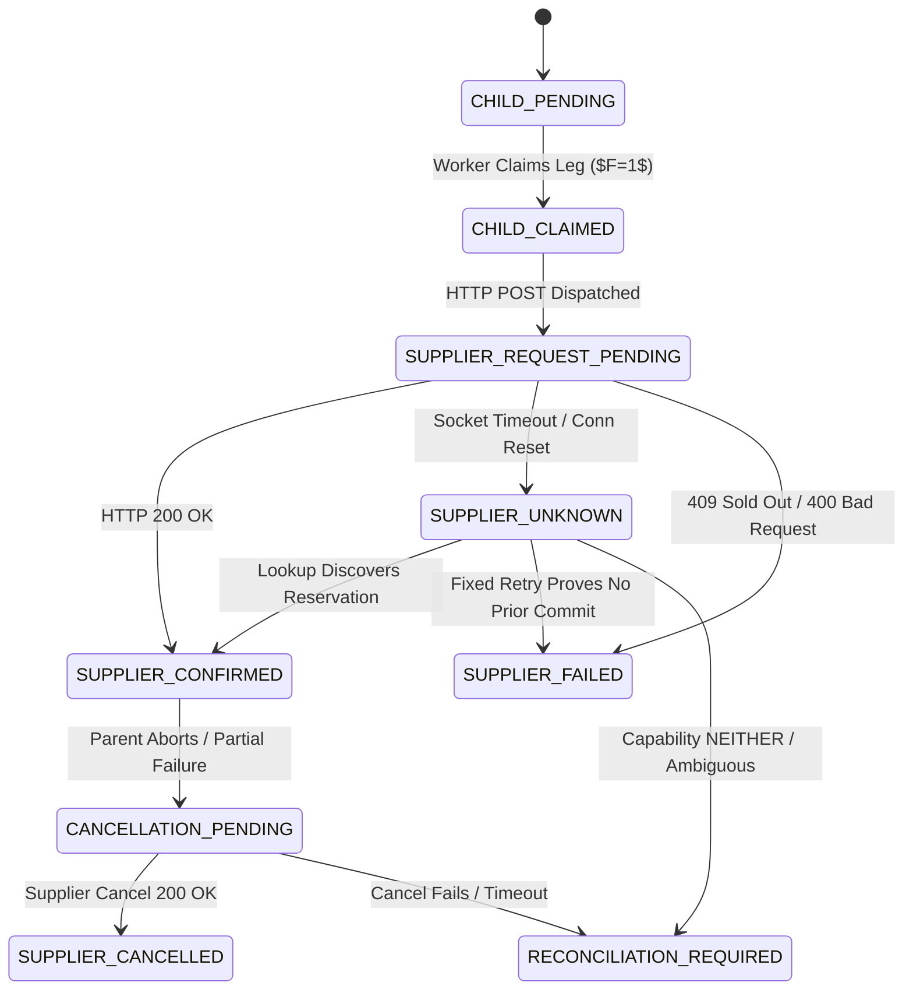

# CROSSWIRE 2.3 — ARCHITECTURE AND FEASIBILITY PROPOSAL
## Multi-Supplier Routing and Split-Inventory Transaction Integrity

**Date:** November 10, 2026  
**Author:** Principal Distributed Systems Architect, Travel Platform Engineering & Security Review  
**Status:** PROPOSED / FEASIBILITY AUDIT  
**Target Milestone:** Crosswire Milestone 2.3  
**Repository:** `C:\Users\jayp9\.gemini\antigravity\scratch\crosswire`  

---

## 1. Current Architecture Assessment (Milestone 2.2 Baseline)

### 1.1 Verified Reusable Capabilities (No Modification Required)
The completion of Milestone 2.2 established a hardened, single-supplier booking transaction platform. The following components are structurally sound and directly reusable:
- **Exact Minor-Unit Arithmetic (`target_platform/money.py`):** Integer minor units (ISO 4217, e.g., INR paise, EUR cents) with half-up rounding, eliminating IEEE-754 floating-point drift across ledger operations.
- **Transactional SQLite Database Architecture (`target_platform/aggregator/database.py`):** Strict foreign-key enforcement (`PRAGMA foreign_keys = ON`), explicit transaction boundaries (`BEGIN IMMEDIATE`), and pre-commit referential integrity validation.
- **Distributed Lease Fencing Primitives (`booking_operation_claims`):** Monotonically increasing fencing tokens ($F \ge 1$), lease timeouts, owner tokens, and state assertions that reject delayed or zombie worker writes with `AggregatorFencingError`.
- **Fail-Closed Supplier Capability Modeling (`target_platform/aggregator/supplier_client.py`):** Explicit declaration of `IDEMPOTENT_WITH_LOOKUP`, `LOOKUP_ONLY`, or `NEITHER`. Undeclared/unknown adapters fail closed to `NEITHER`, prohibiting unsafe blind retries.
- **Webhook HMAC-SHA256 Idempotency Engine:** Provider-scoped cryptographic verification, replay defense, clock-skew bounding ($\pm 300\text{s}$), and atomic state updates.
- **Double-Entry & Single-Entry Ledger Primitives:** Deterministic ledger journaling (`ledger_entries`) supporting balanced multi-leg batches.

### 1.2 Identified Limitations Requiring Architectural Extension
The current M2.2 architecture fundamentally assumes a **1-to-1-to-1 cardinality**:
$$1 \text{ BookingIntent} \iff 1 \text{ BookingRecord} \iff 1 \text{ SupplierReservation} \iff 1 \text{ Voucher}$$

This assumption is embedded across several core subsystems:
1. **Singleton Supplier Field:** `AggregatorBookingRecord.primary_supplier_reservation_id` is a single nullable text column. It cannot hold multiple supplier confirmations for a split booking.
2. **Monolithic Operation Claims:** `booking_operation_claims` keys on `(agency_id, idempotency_key)`, assuming a single supplier dispatch per booking. In a multi-supplier split, $K \ge 2$ independent HTTP dispatches occur, each requiring independent lifecycle tracking, timeouts, and fencing.
3. **Single Supplier Client Endpoint:** `SupplierClient` binds to a single `base_url`. It lacks routing mechanisms to address multiple discrete upstream suppliers (e.g., `Supplier_Alpha`, `Supplier_Beta`).
4. **Binary All-or-Nothing Saga:** `SagaRecoveryWorker` currently cancels a single reservation or releases a single hold. It has no concept of partial saga compensation (e.g., Supplier 1 confirmed, Supplier 2 sold out $\implies$ cancel Supplier 1, release total hold, fail parent booking).
5. **Coupled Voucher Issuance:** `VOUCHER_ISSUED` is triggered immediately upon confirmation of the single reservation. In a split-inventory booking, issuing a voucher before **all** child legs are confirmed represents an existential legal and financial entitlement violation.

---

## 2. Proposed Entity and Database Model

To support multi-supplier fulfillment while preserving atomic transaction integrity, Crosswire 2.3 must introduce a **Parent-Child Hierarchical Transaction Model**.

### 2.1 Entity Relationship Diagram

```
+-------------------------------------------------------------------------------------------------+
|                                    PARENT ENTITIES                                              |
+-------------------------------------------------------------------------------------------------+
|  +-----------------------------+                 +-------------------------------------------+  |
|  |     agencies                | 1             * |          agency_wallets                   |  |
|  |  agency_id (PK)             +-----------------+  wallet_id (PK), agency_id (FK)           |  |
|  +--------------+--------------+                 +---------------------+---------------------+  |
|                 | 1                                                    | 1                      |
|                 |                                                      |                        |
|                 v *                                                    v *                      |
|  +--------------+--------------+                 +---------------------+---------------------+  |
|  |     booking_intents         | 1             1 |           wallet_holds                    |  |
|  |  intent_id (PK)             +-----------------+  hold_id (PK), booking_id (FK)            |  |
|  |  agency_id (FK)             |                 |  amount_minor, status (HELD/CAPTURED)     |  |
|  |  expected_cardinality (K)   |                 +-------------------------------------------+  |
|  |  total_amount_minor         |                                                                |
|  +--------------+--------------+                                                                |
|                 | 1                                                                             |
|                 |                                                                               |
|                 v 1                                                                             |
|  +--------------+--------------+                 +-------------------------------------------+  |
|  |     booking_records         | 1             1 |              vouchers                     |  |
|  |  booking_id (PK)            +-----------------+  voucher_id (PK), booking_id (FK)         |  |
|  |  intent_id (FK)             |                 |  status (ISSUED, CANCELLED)               |  |
|  |  status (PARENT STATE)      |                 +-------------------------------------------+  |
|  +--------------+--------------+                                                                |
+-----------------|-------------------------------------------------------------------------------+
                  | 1
                  |
+-----------------|-------------------------------------------------------------------------------+
|                 v *                CHILD FULFILLMENT ENTITIES                                   |
+-------------------------------------------------------------------------------------------------+
|  +--------------+-------------------+             +------------------------------------------+  |
|  |     child_supplier_intents       | 1         1 |          supplier_reservations           |  |
|  |  child_intent_id (PK)            +-------------+  reservation_id (PK)                     |  |
|  |  parent_booking_id (FK)          |             |  child_intent_id (FK, UNIQUE)            |  |
|  |  supplier_id                     |             |  supplier_id                             |  |
|  |  allocated_amount_minor          |             |  supplier_reservation_id                 |  |
|  |  room_type, check_in, check_out  |             |  status (CONFIRMED, CANCELLED)           |  |
|  |  cancellation_policy_json        |             +------------------------------------------+  |
|  |  status (CHILD STATE)            |                                                           |
|  +--------------+-------------------+                                                           |
|                 | 1                                                                             |
|                 v 1                                                                             |
|  +--------------+-------------------+             +------------------------------------------+  |
|  |   child_operation_claims         |             |       supplier_routing_registry          |  |
|  |  child_intent_id (PK)            |             |  supplier_id (PK)                        |  |
|  |  idempotency_key                 |             |  base_url                                |  |
|  |  fencing_token, owner_token      |             |  capability (NEITHER/LOOKUP/IDEMPOTENT)  |  |
|  |  lease_expires_at, stage         |             |  timeout_ms, is_active                   |  |
|  +----------------------------------+             +------------------------------------------+  |
+-------------------------------------------------------------------------------------------------+
```

### 2.2 Relational DDL Specifications

```sql
-- 1. Upstream Supplier Registry (Enforces Fail-Closed Configuration)
CREATE TABLE IF NOT EXISTS supplier_routing_registry (
    supplier_id TEXT PRIMARY KEY,
    name TEXT NOT NULL,
    base_url TEXT NOT NULL,
    capability TEXT NOT NULL DEFAULT 'NEITHER', -- 'IDEMPOTENT_WITH_LOOKUP', 'LOOKUP_ONLY', 'NEITHER'
    timeout_ms INTEGER NOT NULL DEFAULT 500,
    is_active INTEGER NOT NULL DEFAULT 1,
    created_at TEXT NOT NULL
);

-- 2. Extended Parent Booking Intent
-- Added: expected_cardinality (K >= 1), split_type ('SINGLE', 'MULTI_ROOM', 'SPLIT_STAY')
ALTER TABLE booking_intents ADD COLUMN expected_cardinality INTEGER NOT NULL DEFAULT 1;
ALTER TABLE booking_intents ADD COLUMN split_type TEXT NOT NULL DEFAULT 'SINGLE';

-- 3. Child Supplier Intent (Discrete Upstream Fulfillment Unit)
CREATE TABLE IF NOT EXISTS child_supplier_intents (
    child_intent_id TEXT PRIMARY KEY,
    parent_booking_id TEXT NOT NULL,
    parent_intent_id TEXT NOT NULL,
    agency_id TEXT NOT NULL,
    supplier_id TEXT NOT NULL,
    leg_sequence INTEGER NOT NULL,          -- 1 .. K
    room_type TEXT NOT NULL,
    check_in TEXT NOT NULL,
    check_out TEXT NOT NULL,
    allocated_amount_minor INTEGER NOT NULL,
    currency TEXT NOT NULL,
    cancellation_policy_type TEXT NOT NULL, -- 'FLEXIBLE', 'MODERATE', 'NON_REFUNDABLE'
    cancellation_penalty_rate REAL NOT NULL DEFAULT 0.20,
    status TEXT NOT NULL DEFAULT 'PENDING',  -- 'PENDING', 'DISPATCHED', 'CONFIRMED', 'FAILED', 'CANCELLED'
    created_at TEXT NOT NULL,
    updated_at TEXT NOT NULL,
    FOREIGN KEY (parent_booking_id) REFERENCES booking_records(booking_id),
    FOREIGN KEY (parent_intent_id) REFERENCES booking_intents(intent_id),
    FOREIGN KEY (supplier_id) REFERENCES supplier_routing_registry(supplier_id),
    UNIQUE (parent_booking_id, leg_sequence)
);

-- 4. Supplier Reservation Records (Direct 1:1 Mapping to Confirmed Upstream Leg)
CREATE TABLE IF NOT EXISTS supplier_reservations (
    reservation_id TEXT PRIMARY KEY,
    child_intent_id TEXT UNIQUE NOT NULL,
    parent_booking_id TEXT NOT NULL,
    supplier_id TEXT NOT NULL,
    supplier_reservation_id TEXT NOT NULL,
    amount_minor INTEGER NOT NULL,
    currency TEXT NOT NULL,
    status TEXT NOT NULL DEFAULT 'CONFIRMED', -- 'CONFIRMED', 'CANCELLED', 'UNKNOWN'
    confirmed_at TEXT NOT NULL,
    FOREIGN KEY (child_intent_id) REFERENCES child_supplier_intents(child_intent_id),
    FOREIGN KEY (parent_booking_id) REFERENCES booking_records(booking_id),
    FOREIGN KEY (supplier_id) REFERENCES supplier_routing_registry(supplier_id)
);

-- 5. Child Operation Claims (Independent Distributed Fencing per Upstream Dispatch)
CREATE TABLE IF NOT EXISTS child_operation_claims (
    child_intent_id TEXT PRIMARY KEY,
    parent_booking_id TEXT NOT NULL,
    supplier_id TEXT NOT NULL,
    idempotency_key TEXT NOT NULL,
    status TEXT NOT NULL,                  -- 'CLAIMED', 'REQUEST_PENDING', 'CONFIRMED', 'FAILED', 'RECONCILIATION_REQUIRED'
    owner_token TEXT NOT NULL,
    fencing_token INTEGER NOT NULL DEFAULT 1,
    lease_expires_at TEXT NOT NULL,
    heartbeat_at TEXT NOT NULL,
    last_owner_token TEXT,
    retry_count INTEGER DEFAULT 0,
    created_at TEXT NOT NULL,
    updated_at TEXT NOT NULL,
    FOREIGN KEY (child_intent_id) REFERENCES child_supplier_intents(child_intent_id),
    FOREIGN KEY (parent_booking_id) REFERENCES booking_records(booking_id)
);
```

### 2.3 Distinction: Legitimate Multi-Reservation vs. Accidental Duplication
In M2.2, any intent having $>1$ reservation was a fatal invariant violation (CW-INV-5.2). In M2.3, the invariant oracle must distinguish legitimate split fulfillment from accidental double-booking:

- **Legitimate Multi-Reservation:**
  A parent booking with `expected_cardinality = K` ($K \ge 2$) where:
  1. Exactly $K$ active child intents exist: $\{C_1, C_2, \dots, C_K\}$.
  2. Each confirmed reservation links to a **distinct** `child_intent_id`:
     $$\forall i \neq j, \quad \text{child\_intent\_id}(R_i) \neq \text{child\_intent\_id}(R_j)$$
  3. Total confirmed reservations equal $K$:
     $$|\{R \in \text{Reservations} \mid \text{status}(R) = \text{'CONFIRMED'}\}| = K$$
  4. Each supplier reservation ID is unique.

- **Accidental Duplicate Reservation (Violation):**
  1. Multiple reservations mapped to the **same** `child_intent_id`:
     $$\exists R_a, R_b \quad (a \neq b) \quad \text{such that} \quad \text{child\_intent\_id}(R_a) = \text{child\_intent\_id}(R_b)$$
  2. Total confirmed reservations exceed expected cardinality:
     $$|\{R \in \text{Reservations} \mid \text{status}(R) = \text{'CONFIRMED'}\}| > K$$
  3. A single upstream supplier executes two distinct bookings under the same child idempotency key.

---

## 3. State Machine Diagrams

### 3.1 Parent Booking State Machine



### 3.2 Child Supplier Intent State Machine



---

## 4. Parent/Child Transaction Lifecycle

```
====================================================================================================
TIME   ORCHESTRATOR               DATABASE                    SUPPLIER ALPHA       SUPPLIER BETA
====================================================================================================
t0     Receive Split Intent (K=2)
t1     Validate Σ Allocated == Total
t2     -------------------------> BEGIN IMMEDIATE
                                  Save Parent Intent
                                  Save Child Intents (C1, C2)
                                  Create Parent Claim
                                  COMMIT
t3     Lock Total Wallet Hold --> Deduct Active Balance
t4     Fork Concurrent Dispatches
t5     Worker A claims C1 ------> Acquire Claim C1 (F=1)
t6     Worker B claims C2 ------> Acquire Claim C2 (F=1)
t7     Worker A HTTP POST ----------------------------------> POST /reservations
t8     Worker B HTTP POST --------------------------------------------------------> POST /reservations
t9                                                            HTTP 200 (RES-A1)
t10    Worker A confirms C1 ----> Save Reservation A1
t11                                                                                HTTP 409 (SOLD OUT)
t12    Worker B fails C2 -------> Record Child C2 FAILED
t13    ORCHESTRATOR DETECTS PARTIAL FAILURE (C1=CONFIRMED, C2=FAILED)
t14    Transition Parent: PARTIAL_FAILURE -> COMPENSATING
t15    Trigger Saga: Cancel A1 -> POST /cancel (RES-A1) ----> Cancel A1
t16                                                            HTTP 200 (CANCELLED)
t17    Release Parent Hold -----> Release Wallet Hold (Full ₹15,000 returned to agency balance)
t18    Final State -------------> Mark Parent FAILED, Voucher = NULL
====================================================================================================
```

---

## 5. Supplier Routing Strategy & Capability Fail-Closed Model

The aggregator must interact with multiple heterogeneous upstream hotel suppliers. Each supplier adapter possesses distinct distributed capabilities:

```python
class SupplierCapability(str, Enum):
    IDEMPOTENT_WITH_LOOKUP = "IDEMPOTENT_WITH_LOOKUP"  # Native header idempotency + query endpoint
    LOOKUP_ONLY = "LOOKUP_ONLY"                        # Reference query supported; blind POST non-idempotent
    NEITHER = "NEITHER"                                # Legacy; no query, no idempotency (FAIL CLOSED)
```

### 5.1 Routing Registry Interface
```python
class ISupplierRouter(ABC):
    @abstractmethod
    def get_adapter(self, supplier_id: str) -> SupplierAdapter:
        """
        Resolves adapter by supplier_id.
        FAIL-CLOSED REQUIREMENT: If supplier_id is unknown, inactive, or unconfigured,
        MUST raise UnregisteredSupplierError. Never fall back to a default mock adapter.
        """
        pass
```

### 5.2 Upstream Failure Matrix & Policy Enforcement

| Supplier Capability | Initial Dispatch Timeout Action | Post-Timeout Lookup Action | Cancellation Timeout Action |
| :--- | :--- | :--- | :--- |
| **IDEMPOTENT_WITH_LOOKUP** | Safe to re-query reference; if not found, safe to replay with stable child idempotency key. | If located $\implies$ Adopt. If not located $\implies$ Redispatch once. | Query cancellation status; retry cancellation with stable idempotency key. |
| **LOOKUP_ONLY** | Query reference endpoint. | If located $\implies$ Adopt. If not located $\implies$ **DO NOT REDISPATCH**. Halt in `RECONCILIATION_REQUIRED`. | Query status; if confirmed, require manual operator cancellation. |
| **NEITHER** | **DO NOT RETRY**. Mark child leg `SUPPLIER_UNKNOWN`. | Lookup unsupported $\implies$ Halt immediately. | Transition child leg to `RECONCILIATION_REQUIRED`. Durable saga record created. |

---

## 6. Financial Equations and Business Invariants

### 6.1 Equation 1: Principle of Allocation Completeness
The consolidated parent booking amount must exactly equal the sum of child leg financial allocations, with identical currency:
$$\text{Parent.amount\_minor} = \sum_{i=1}^K \text{ChildIntent}_i\text{.allocated\_amount\_minor}$$
$$\forall i \in \{1 \dots K\}, \quad \text{ChildIntent}_i\text{.currency} = \text{Parent.currency}$$
*Violation condition:* Any discrepancy ($\Delta \neq 0$) or currency mismatch fails intent validation immediately before any wallet hold is reserved.

### 6.2 Equation 2: Wallet Hold and Capture Boundedness
Only a single consolidated wallet hold is reserved for the parent booking to avoid multiple hold-setup race conditions:
$$\text{Hold.amount\_minor} = \text{Parent.amount\_minor}$$
During capture (upon successful confirmation of all $K$ child legs):
$$\text{Captured.amount\_minor} = \text{Hold.amount\_minor} = \sum_{i=1}^K \text{ConfirmedReservation}_i\text{.amount\_minor}$$
*Partial Failure Condition:* If any child leg fails, capture **must not execute**. $\text{Captured.amount\_minor} = 0$, and the hold is released in full:
$$\text{Wallet.active\_holds} \leftarrow \text{Wallet.active\_holds} - \text{Hold.amount\_minor}$$

### 6.3 Equation 3: Multi-Leg Bounded Refund Entitlement
When an agency cancels a confirmed split booking, each child leg evaluates its own cancellation penalty based on its upstream supplier contract:
$$\text{Penalty\_minor}_i = \text{round\_minor}\left(\text{ChildIntent}_i\text{.allocated\_amount\_minor} \times \text{Rate}_i\right)$$
$$\text{LegEntitlement\_minor}_i = \text{ChildIntent}_i\text{.allocated\_amount\_minor} - \text{Penalty\_minor}_i$$
The total parent refundable entitlement is strictly additive:
$$\text{TotalEntitlement\_minor} = \sum_{i=1}^K \text{LegEntitlement\_minor}_i$$
$$\text{TotalRefunded\_minor} \le \text{TotalEntitlement\_minor} \le \text{Parent.amount\_minor}$$

### 6.4 Invariant Matrix (Master Plan Section 5 Alignment)

| Invariant | Single-Supplier (M2.2) Definition | Split-Inventory (M2.3) Extension |
| :--- | :--- | :--- |
| **5.1 (Wallet Balance)** | Balance = Open + Posted Ledger. | Unchanged. Consolidated debit posted only when **all $K$ legs confirm**. |
| **5.2 (Reservation Uniqueness)** | Exactly 1 confirmed reservation per intent. | **Cardinality Bound:** Confirmed reservations linked to parent intent must equal declared $K$. Exactly 1 per child intent. No duplicates allowed. |
| **5.3 (Webhook Idempotency)** | 1 provider event = at most 1 ledger effect. | Unchanged. Webhook must reference specific child reservation or parent refund ID. |
| **5.4 (Voucher Entitlement)** | Voucher issued iff 1 reservation confirmed. | **All-or-Nothing Voucher Rule:** Voucher issuance strictly prohibited unless $|\text{Confirmed Legs}| = K$ **AND** wallet capture is completed. |
| **5.5 (Refund Boundedness)** | $\sum \text{Refunds} \le \text{Entitlement}$. | Multi-leg entitlement sum: $\sum \text{Refunds} \le \sum_{i=1}^K \text{LegEntitlement}_i$. |
| **5.6 (State Transitions)** | Strict parent state transition machine. | Parent cannot enter `SUPPLIER_CONFIRMED` while any child is in `PENDING`, `FAILED`, or `UNKNOWN`. |
| **5.7 (Double-Entry Batch)** | $\sum \text{Debits} = \sum \text{Credits}$. | Journal entries for split bookings credit each upstream supplier payable sub-account: $\text{Dr Agency Wallet} = \sum_{i=1}^K \text{Cr SupplierPayable}_i$. |

---

## 7. Adversarial Scenario Matrix (The 10 Required Failure Modes)

| Scenario ID | Failure Description | Vulnerable Behavior (Naive Impl) | Fixed Resilient Behavior (M2.3 Proposal) |
| :--- | :--- | :--- | :--- |
| **ADV-2.3-01** | **All Suppliers Succeed** (Happy Path) | Dispatches asynchronously without synchronizing completion; emits voucher before second leg confirms. | Scatter-gather orchestrator awaits all $K$ child futures; verifies $|\text{Confirmed}| = K$; executes atomic parent state update; issues single parent voucher. |
| **ADV-2.3-02** | **Supplier 1 Confirmed, Supplier 2 Sold Out** | Leaves Supplier 1 confirmed; deducts partial funds; leaves customer stranded with 1 of 2 required rooms. | Atomically records Supplier 2 `FAILED`; transitions parent to `COMPENSATING`; dispatches saga cancellation for Supplier 1; releases entire wallet hold; marks parent `FAILED`. Zero customer charge. |
| **ADV-2.3-03** | **Supplier 1 Commits, Response Lost (Timeout)** | Aggregator treats timeout as failure, books alternate or cancels Supplier 2, creating orphaned reservation. | Enforces supplier capability: If `IDEMPOTENT`, queries lookup reference. If found, adopts. If `NEITHER`, transitions child leg to `SUPPLIER_UNKNOWN`, holds wallet, halts parent in `RECONCILIATION_REQUIRED`. |
| **ADV-2.3-04** | **Both Commit, Aggregator Dies Before Recording** | Both reservations exist upstream; customer sees error; aggregator database has no record; agency double-charged. | Persistent `child_operation_claims` with stage `SUPPLIER_REQUEST_PENDING`. Post-crash recovery worker leases claims ($F=2$), reconciles upstream reservations, and completes parent state to `SUPPLIER_CONFIRMED`. |
| **ADV-2.3-05** | **Cancellation Races with Delayed Confirmation** | Cancellation succeeds for Leg 1; Leg 2 confirmation arrives late and confirms room; voucher issued on cancelled booking. | Cancellation acquires master booking claim ($F \leftarrow F+1$). When delayed Leg 2 returns, its commit write is **rejected by database fencing token check**. Saga cancels delayed Leg 2 immediately. |
| **ADV-2.3-06** | **Leg 1 Cancellation Fails, Leg 2 Succeeds** | Aggregator silently ignores Leg 1 failure, marks parent `CANCELLED`, issues full refund, leaking Supplier 1 cost. | Records durable `saga_recovery_records` for Leg 1; parent enters `RECONCILIATION_REQUIRED`; refund for Leg 1 is blocked until cancellation is confirmed or operator intervenes. |
| **ADV-2.3-07** | **Concurrent Child Intent Retry** | Rapid client double-clicks dispatch two simultaneous threads to Supplier 1, producing duplicate room reservations. | Unique database claim on `(parent_booking_id, leg_sequence)`. Second thread blocked by row lock or fails claim acquisition (`acquired=False`); waits on first thread outcome. |
| **ADV-2.3-08** | **Partial Refund Request** (1 of 2 legs cancelled post-stay) | Aggregator applies full-booking penalty formula, incorrectly calculating refund entitlement. | Evaluates cancellation policy of the specific cancelled leg; computes `Penalty_minor_1`; credits wallet strictly for `LegEntitlement_1`; leaves Leg 2 active and accounted. |
| **ADV-2.3-09** | **Recovery Worker Restarts Mid-Compensation** | In-flight recovery crashes; task is forgotten; upstream reservations remain active indefinitely. | Tasks persisted in `saga_recovery_records` with dynamic leases (`lease_expires_at`). Restarted worker scans expired leases ($F \leftarrow F+1$), re-evaluates upstream state, and completes compensation. |
| **ADV-2.3-10** | **Cross-Tenant Leg Association** (Tenant Injection) | Malicious agency crafts request associating Child Intent from Agency B into Parent Booking of Agency A. | Strict tenant validation in `child_supplier_intents`: `agency_id` on child record must match `agency_id` on parent booking record; enforced via database foreign keys and query filters. |

---

## 8. Failure and Recovery Behavior

### 8.1 Partial Allocation Compensation Flow
When Leg 1 confirms but Leg 2 fails (Scenario ADV-2.3-02), the system must guarantee eventual consistency:

```
[Leg 2 Returns 409 / Sold Out]
          |
          v
[Database Transaction (Atomic)]
   |-- Update child_supplier_intents(C2) -> status = 'FAILED'
   |-- Update booking_records -> status = 'PARTIAL_DISPATCH_FAILED'
   |-- Insert saga_recovery_records (Action: CANCEL_CHILD_RESERVATION, Target: Leg 1)
   +-- COMMIT
          |
          v
[Dispatch Compensation for Leg 1]
   |-- Supplier A Adapter -> call_cancel_reservation(RES-A1)
   |-- If Success (200 OK):
   |      Update child_supplier_intents(C1) -> status = 'CANCELLED'
   |      Update supplier_reservations(RES-A1) -> status = 'CANCELLED'
   |      Release Consolidated Wallet Hold (100% funds restored)
   |      Update booking_records -> status = 'FAILED'
   |      Update saga_recovery_records -> status = 'COMPENSATED'
   |
   +-- If Timeout / Error (Network Drop):
          Update child_supplier_intents(C1) -> status = 'RECONCILIATION_REQUIRED'
          Update booking_records -> status = 'RECONCILIATION_REQUIRED'
          Update saga_recovery_records -> status = 'PENDING', next_attempt_at = now + backoff
          Wallet hold REMAINS ACTIVE (Prevents agency from spending funds that may owe upstream)
          Background SagaRecoveryWorker resumes retry
```

---

## 9. Architecture Options: Trade-Off Analysis

### 9.1 Option A: Sequential Pipeline with Immediate Rollback
The orchestrator dispatches Leg 1. Only after Leg 1 succeeds does it dispatch Leg 2. If Leg 2 fails, it rolls back Leg 1.
- **Pros:**
  - Simple state coordination; minimal concurrency complexity.
  - Zero risk of Leg 2 succeeding if Leg 1 fails.
- **Cons:**
  - **Latency Bloat:** End-to-end latency is the sum of all supplier latencies: $T_{\text{total}} = \sum_{i=1}^K T_i$. In travel APIs where suppliers routinely take 1.5–3.0s, $K=3$ would result in unacceptable 9s user response times.
  - **Inventory Expiry Window:** While waiting for Leg 2 to confirm, Leg 1 inventory hold may expire or rate rules may change.

### 9.2 Option B: Scatter-Gather Orchestration with Distributed Sub-Claims (Recommended)
The orchestrator dispatches all $K$ child legs concurrently using `asyncio.gather()` or parallel worker threads. Each child leg possesses its own fenced claim. The orchestrator collects results and coordinates the final aggregate commit or compensating saga.
- **Pros:**
  - **Optimal Latency:** Total response time bounded by the slowest supplier: $T_{\text{total}} = \max(T_1, \dots, T_K)$.
  - Fast feedback to the user on sold-out rooms.
- **Cons:**
  - Higher orchestration complexity.
  - Frequent partial rollbacks if one supplier is flaky or sold out.
  - Requires fine-grained database locking on child records.

### 9.3 Architectural Decision
**We recommend Option B (Scatter-Gather with Distributed Sub-Claims).**  
In modern B2B travel distribution, multi-room and split bookings must meet strict SLA thresholds (typically $< 3.5\text{s}$). Sequential dispatching is commercially unviable. Concurrency risks are fully mitigated by our proven database leasing, fencing tokens, and reliable saga compensation engine.

---

## 10. Database Migration Considerations

To preserve all working Milestone 2.2 functionality, database migration for M2.3 must adhere strictly to our verified transactional standards:
1. **Zero Breaking Changes on M2.2 Tables:** Existing tables (`booking_records`, `booking_intents`, `refund_records`) receive nullable or defaulted columns only (`expected_cardinality DEFAULT 1`). Existing M2.2 single-room bookings will run transparently through the parent-child engine with $K=1$.
2. **Explicit Atomic DDL Migration:**
   - Execute `PRAGMA foreign_keys = OFF` outside transaction.
   - Run `BEGIN IMMEDIATE`.
   - Create new child tables (`child_supplier_intents`, `supplier_reservations`, `child_operation_claims`, `supplier_routing_registry`).
   - Validate with `PRAGMA foreign_key_check` before commit.
   - Restore `PRAGMA foreign_keys = ON` in `finally:`.
3. **Rollback Safety:** Automated migration failure-injection tests must be retained and expanded to verify that new table DDL can roll back completely on disk corruption.

---

## 11. Test Strategy and Acceptance Criteria

### 11.1 Verification Strategy
1. **Preservation Suite:** All existing 196 tests from M2.2 must run and pass unconditionally with zero modifications.
2. **Multi-Supplier Mock Harness:** Implement `Supplier_Alpha` (port 8011) and `Supplier_Beta` (port 8012) as discrete mock server instances with configurable latency and error injection.
3. **Scatter-Gather Concurrency Tests:** Verify 20 concurrent split-booking attempts ($2 \times 20 = 40$ supplier reservations) on shared inventory without deadlocks or missing records.
4. **Adversarial Suite:** Implement dedicated tests for each of the 10 scenarios in Section 7:
   - Prove that ADV-2.3-02 cancels Supplier 1, releases wallet hold, and issues no voucher.
   - Prove that ADV-2.3-05 rejects delayed confirmations via database fencing tokens.
   - Prove that ADV-2.3-07 enforces uniqueness on `(parent_booking_id, leg_sequence)`.

### 11.2 Acceptance Criteria
- [ ] $\sum \text{Allocations} \equiv \text{Parent Amount}$ enforced across all split intents.
- [ ] No voucher emitted if $|\text{Confirmed Legs}| < K$.
- [ ] No double-charging or orphaned supplier reservations on partial sold-out failures.
- [ ] Zero IEEE-754 drift across split refund calculations.
- [ ] Full regression suite passes: $196 + N \text{ new tests} = \text{Total Passing}$.

---

## 12. Scope Exclusions (Explicit Non-Goals)

To prevent scope bloat and preserve engineering integrity, the following are strictly out of scope for Milestone 2.3:
- **Foreign Exchange & Currency Drift:** All child allocations must match parent currency (`INR` or `EUR`). No cross-currency exchange rates.
- **Non-Hotel Travel Verticals:** No air (GDS/NDC), car rental, or rail booking components.
- **Dynamic Packaging:** No cross-vertical bundling rules or package markup margin engines.
- **Automated Supplier Contract Renegotiation:** Supplier cancellation penalty tiers are statically configured in registry tables.

---

## 13. Devil's Advocate: Risks & Unresolved Decisions

1. **Unavoidable Manual Reconciliation (The Real-World Reality):**
   If Supplier Alpha commits a reservation, drops the socket connection, and declares capability `NEITHER` (no query, no idempotency), and Supplier Beta returns `SOLD OUT`, software cannot safely cancel Supplier Alpha automatically (it doesn't know the reservation ID), nor can it complete the parent booking. **Manual human intervention is mathematically unavoidable in this state.** The system must guarantee that:
   - The agency wallet is **not** debited.
   - The hold is **not** prematurely released (preventing unbacked agency withdrawal).
   - Clear diagnostic audit logs are emitted for the operations desk.
2. **Upstream Inventory Flapping:**
   In scatter-gather dispatching, room rates and availability may change within milliseconds between Quote and Hold. If Supplier Alpha confirms at ₹8,000 but Supplier Beta returns a price change (₹7,500 $\to$ ₹9,000), Crosswire must treat this as a partial failure and abort both legs.
3. **SQLite Concurrency Contention:**
   Running concurrent child dispatches with high write frequency against SQLite may encounter `database is locked` (`busy_timeout`). While acceptable in a synthetic testbed with WAL mode and serialized transactions, high-throughput production would require PostgreSQL with row-level locking (`SELECT FOR UPDATE`).

---

## 14. Final Recommendation

### Recommendation: **CONDITIONAL GO**

**Conditions for Execution:**
1. **Strict Phasing:** Milestone 2.3 must be implemented in two isolated sub-phases:
   - *Phase 2.3A (Data Model & Multi-Supplier Registry):* Create tables, supplier routing registry, and sequential positive controls.
   - *Phase 2.3B (Scatter-Gather Orchestration & Adversarial Compensation):* Implement concurrent dispatches, partial saga compensation, and the 10 adversarial test scenarios.
2. **Zero Regression Guarantee:** The 196 existing M2.2 tests must run in CI on every commit. Any change modifying existing M2.2 single-supplier behavior must be immediately rejected.
3. **Strict Scope Lockdown:** Reject any request for FX conversion, flights, or multi-currency bundling during this milestone.

---
*End of Architectural Proposal — Milestone 2.3*
