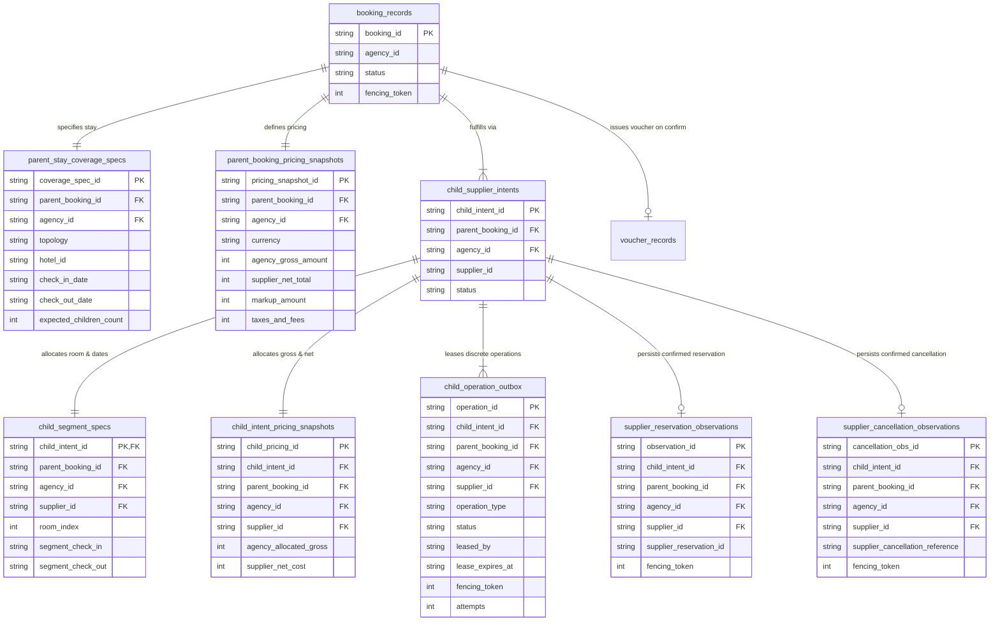

# Milestone 2.3 Architecture Proposal V3: Multi-Supplier Routing & Split-Inventory Transaction Integrity
## Final Technical Specification Before Implementation

**Document Reference:** `MILESTONE_2_3_ARCHITECTURE_PROPOSAL_V3.md`  
**Author:** Principal Distributed Systems & Database Architect  
**Review Status:** Pre-Implementation Specification Gate  
**Target Milestone:** Crosswire 2.3 (Split-Inventory & Multi-Supplier Transactional Integrity)  
**Baseline Verification:** Milestone 2.2 Frozen Baseline — 196 passed, 0 failed, 1 warning (100% green)

---

## Executive Summary & Architecture Scope

Crosswire 2.3 extends the single-supplier booking engine developed in Milestones 2.1 and 2.2 to support **multi-supplier fulfillment and split-inventory hotel itineraries** while maintaining non-negotiable transactional, financial, and relational integrity.

### Operational Boundaries & Scope Lockdown
1. **Vertical Exclusivity:** Hotel accommodations only. Flights, rail, car rentals, and dynamic packaging are strictly excluded.
2. **Geographic Consistency:** A single logical parent booking must belong to exactly **one property** (`hotel_id`). Cross-property itineraries are strictly prohibited within a single parent booking.
3. **Supported Itinerary Topologies:**
   - **`MULTI_ROOM`:** Up to 2 rooms at the same hotel for the exact same check-in/check-out dates, fulfilled across 1 or 2 distinct suppliers.
   - **`SPLIT_STAY`:** Exactly 1 room at the same hotel spanning 2 consecutive non-overlapping date segments (e.g. Nights 1–2 via Supplier Alpha, Nights 3–4 via Supplier Beta).
4. **Financial Consistency:**
   - Single currency per logical booking (default `USD`).
   - All financial amounts are integer minor units (e.g. cents).
   - Zero currency conversion, FX float, or cross-currency settlement.
5. **No Production Claims:** This architecture provides a deterministic, fault-tolerant platform for local, simulated, and staging environments, with human-in-the-loop operational escalation for ambiguous supplier outcomes.

---

## 1. Complete SQLite-Compatible DDL

In SQLite, constraints such as `CHECK`, `FOREIGN KEY`, and `PRIMARY KEY` cannot be added to an existing table using `ALTER TABLE ... ADD CONSTRAINT`. All constraints must be defined directly within `CREATE TABLE` statements or via safe table recreation migrations.

The DDL below defines the complete schema for Crosswire 2.3, using strictly valid SQLite syntax.

```sql
-- ============================================================================
-- PREREQUISITE: Composite unique index on existing booking_records table
-- Required to allow composite foreign keys (parent_booking_id, agency_id)
-- ============================================================================
CREATE UNIQUE INDEX IF NOT EXISTS uidx_booking_records_id_agency 
ON booking_records (booking_id, agency_id);

-- ============================================================================
-- 1. PARENT STAY COVERAGE SPECIFICATION
-- Defines the requested topological stay requirements for the parent booking
-- ============================================================================
CREATE TABLE IF NOT EXISTS parent_stay_coverage_specs (
    coverage_spec_id TEXT PRIMARY KEY,
    parent_booking_id TEXT NOT NULL,
    agency_id TEXT NOT NULL,
    topology TEXT NOT NULL CHECK (topology IN ('SINGLE_ROOM', 'MULTI_ROOM', 'SPLIT_STAY')),
    hotel_id TEXT NOT NULL,
    check_in_date TEXT NOT NULL,        -- ISO 8601 YYYY-MM-DD
    check_out_date TEXT NOT NULL,       -- ISO 8601 YYYY-MM-DD
    expected_children_count INTEGER NOT NULL CHECK (expected_children_count BETWEEN 1 AND 2),
    total_rooms INTEGER NOT NULL CHECK (total_rooms BETWEEN 1 AND 2),
    total_guest_capacity INTEGER NOT NULL CHECK (total_guest_capacity > 0),
    created_at TEXT NOT NULL,
    FOREIGN KEY (parent_booking_id, agency_id) 
        REFERENCES booking_records (booking_id, agency_id) ON DELETE RESTRICT,
    CHECK (check_out_date > check_in_date)
);

CREATE UNIQUE INDEX IF NOT EXISTS uidx_parent_coverage_booking 
ON parent_stay_coverage_specs (parent_booking_id);

-- ============================================================================
-- 2. PARENT BOOKING PRICING SNAPSHOT
-- Captures agency gross, markup, taxes, and cancellation terms in integer minor units
-- ============================================================================
CREATE TABLE IF NOT EXISTS parent_booking_pricing_snapshots (
    pricing_snapshot_id TEXT PRIMARY KEY,
    parent_booking_id TEXT NOT NULL,
    agency_id TEXT NOT NULL,
    currency TEXT NOT NULL CHECK (length(currency) = 3),
    agency_gross_amount INTEGER NOT NULL CHECK (agency_gross_amount > 0),
    supplier_net_total INTEGER NOT NULL CHECK (supplier_net_total > 0),
    markup_amount INTEGER NOT NULL CHECK (markup_amount >= 0),
    taxes_and_fees INTEGER NOT NULL CHECK (taxes_and_fees >= 0),
    agency_cancellation_penalty_bps INTEGER NOT NULL DEFAULT 0 CHECK (agency_cancellation_penalty_bps BETWEEN 0 AND 10000),
    version INTEGER NOT NULL DEFAULT 1,
    created_at TEXT NOT NULL,
    FOREIGN KEY (parent_booking_id, agency_id) 
        REFERENCES booking_records (booking_id, agency_id) ON DELETE RESTRICT,
    CHECK (agency_gross_amount = supplier_net_total + markup_amount + taxes_and_fees)
);

CREATE UNIQUE INDEX IF NOT EXISTS uidx_parent_pricing_booking 
ON parent_booking_pricing_snapshots (parent_booking_id);

-- ============================================================================
-- 3. CHILD SUPPLIER INTENTS
-- Discrete fulfillment legs linking a parent booking to a specific supplier
-- ============================================================================
CREATE TABLE IF NOT EXISTS child_supplier_intents (
    child_intent_id TEXT PRIMARY KEY,
    parent_booking_id TEXT NOT NULL,
    agency_id TEXT NOT NULL,
    supplier_id TEXT NOT NULL,
    status TEXT NOT NULL CHECK (status IN (
        'PENDING', 
        'DISPATCHED', 
        'CONFIRMED', 
        'DEFINITIVE_FAILURE', 
        'SUPPLIER_UNKNOWN', 
        'CANCELLATION_PENDING', 
        'CANCELLED', 
        'RECONCILIATION_REQUIRED'
    )),
    created_at TEXT NOT NULL,
    updated_at TEXT NOT NULL,
    FOREIGN KEY (parent_booking_id, agency_id) 
        REFERENCES booking_records (booking_id, agency_id) ON DELETE RESTRICT
);

-- Enables composite foreign keys from downstream child tables
CREATE UNIQUE INDEX IF NOT EXISTS uidx_child_intents_composite 
ON child_supplier_intents (child_intent_id, parent_booking_id, agency_id, supplier_id);

CREATE INDEX IF NOT EXISTS idx_child_intents_parent 
ON child_supplier_intents (parent_booking_id);

-- ============================================================================
-- 4. CHILD SEGMENT SPECIFICATIONS
-- Defines the specific room and date interval fulfilled by this child intent
-- ============================================================================
CREATE TABLE IF NOT EXISTS child_segment_specs (
    child_intent_id TEXT PRIMARY KEY,
    parent_booking_id TEXT NOT NULL,
    agency_id TEXT NOT NULL,
    supplier_id TEXT NOT NULL,
    room_index INTEGER NOT NULL CHECK (room_index BETWEEN 0 AND 1),
    segment_check_in TEXT NOT NULL,     -- ISO 8601 YYYY-MM-DD
    segment_check_out TEXT NOT NULL,    -- ISO 8601 YYYY-MM-DD
    room_type_code TEXT NOT NULL,
    guest_capacity INTEGER NOT NULL CHECK (guest_capacity > 0),
    FOREIGN KEY (child_intent_id, parent_booking_id, agency_id, supplier_id)
        REFERENCES child_supplier_intents (child_intent_id, parent_booking_id, agency_id, supplier_id) ON DELETE RESTRICT,
    CHECK (segment_check_out > segment_check_in)
);

CREATE INDEX IF NOT EXISTS idx_child_segment_parent 
ON child_segment_specs (parent_booking_id);

-- ============================================================================
-- 5. CHILD INTENT PRICING SNAPSHOTS
-- Detailed financial allocation per child leg (agency gross allocation, net, markup)
-- ============================================================================
CREATE TABLE IF NOT EXISTS child_intent_pricing_snapshots (
    child_pricing_id TEXT PRIMARY KEY,
    child_intent_id TEXT NOT NULL,
    parent_booking_id TEXT NOT NULL,
    agency_id TEXT NOT NULL,
    supplier_id TEXT NOT NULL,
    agency_allocated_gross INTEGER NOT NULL CHECK (agency_allocated_gross > 0),
    supplier_net_cost INTEGER NOT NULL CHECK (supplier_net_cost > 0),
    allocated_markup INTEGER NOT NULL CHECK (allocated_markup >= 0),
    allocated_taxes INTEGER NOT NULL CHECK (allocated_taxes >= 0),
    supplier_cancellation_penalty_bps INTEGER NOT NULL DEFAULT 0 CHECK (supplier_cancellation_penalty_bps BETWEEN 0 AND 10000),
    created_at TEXT NOT NULL,
    FOREIGN KEY (child_intent_id, parent_booking_id, agency_id, supplier_id)
        REFERENCES child_supplier_intents (child_intent_id, parent_booking_id, agency_id, supplier_id) ON DELETE RESTRICT,
    CHECK (agency_allocated_gross = supplier_net_cost + allocated_markup + allocated_taxes)
);

CREATE UNIQUE INDEX IF NOT EXISTS uidx_child_pricing_intent 
ON child_intent_pricing_snapshots (child_intent_id);

-- ============================================================================
-- 6. UNIFIED TRANSACTIONAL OUTBOX & OPERATION LEASES
-- Single authoritative store for operation identity, dispatch payload, leases, and fencing
-- ============================================================================
CREATE TABLE IF NOT EXISTS child_operation_outbox (
    operation_id TEXT PRIMARY KEY,       -- Format: "{child_intent_id}:{operation_type}:{attempt}"
    child_intent_id TEXT NOT NULL,
    parent_booking_id TEXT NOT NULL,
    agency_id TEXT NOT NULL,
    supplier_id TEXT NOT NULL,
    operation_type TEXT NOT NULL CHECK (operation_type IN (
        'CREATE_RESERVATION', 
        'CANCEL_RESERVATION', 
        'LOOKUP_RESERVATION', 
        'LOOKUP_CANCELLATION'
    )),
    status TEXT NOT NULL CHECK (status IN (
        'PENDING', 
        'IN_PROGRESS', 
        'SUCCEEDED', 
        'FAILED', 
        'EXHAUSTED', 
        'RECONCILIATION_REQUIRED'
    )),
    leased_by TEXT,
    lease_expires_at TEXT,
    fencing_token INTEGER NOT NULL DEFAULT 1 CHECK (fencing_token > 0),
    attempts INTEGER NOT NULL DEFAULT 0 CHECK (attempts >= 0),
    max_attempts INTEGER NOT NULL DEFAULT 3 CHECK (max_attempts > 0),
    supplier_capability_snapshot TEXT NOT NULL, -- JSON snapshot of capability at dispatch
    payload_hash TEXT NOT NULL,
    payload_json TEXT NOT NULL,
    durable_outcome_json TEXT,
    created_at TEXT NOT NULL,
    updated_at TEXT NOT NULL,
    FOREIGN KEY (child_intent_id, parent_booking_id, agency_id, supplier_id)
        REFERENCES child_supplier_intents (child_intent_id, parent_booking_id, agency_id, supplier_id) ON DELETE RESTRICT
);

CREATE INDEX IF NOT EXISTS idx_outbox_polling 
ON child_operation_outbox (status, lease_expires_at);

CREATE INDEX IF NOT EXISTS idx_outbox_child_type 
ON child_operation_outbox (child_intent_id, operation_type);

-- ============================================================================
-- 7. SUPPLIER RESERVATION OBSERVATIONS
-- Durable, immutable evidence of confirmed supplier reservations
-- ============================================================================
CREATE TABLE IF NOT EXISTS supplier_reservation_observations (
    observation_id TEXT PRIMARY KEY,
    child_intent_id TEXT NOT NULL,
    parent_booking_id TEXT NOT NULL,
    agency_id TEXT NOT NULL,
    supplier_id TEXT NOT NULL,
    supplier_reservation_id TEXT NOT NULL,
    observed_at TEXT NOT NULL,
    fencing_token INTEGER NOT NULL CHECK (fencing_token > 0),
    raw_response_hash TEXT NOT NULL,
    payload_snapshot TEXT NOT NULL,
    FOREIGN KEY (child_intent_id, parent_booking_id, agency_id, supplier_id)
        REFERENCES child_supplier_intents (child_intent_id, parent_booking_id, agency_id, supplier_id) ON DELETE RESTRICT
);

-- Exactly one confirmed reservation per child intent
CREATE UNIQUE INDEX IF NOT EXISTS uidx_obs_child_unique 
ON supplier_reservation_observations (child_intent_id);

-- Enforce global uniqueness: supplier cannot return duplicate reservation IDs
CREATE UNIQUE INDEX IF NOT EXISTS uidx_obs_supplier_reservation 
ON supplier_reservation_observations (supplier_id, supplier_reservation_id);

-- ============================================================================
-- 8. SUPPLIER CANCELLATION OBSERVATIONS
-- Durable, immutable evidence of supplier cancellation confirmations
-- ============================================================================
CREATE TABLE IF NOT EXISTS supplier_cancellation_observations (
    cancellation_obs_id TEXT PRIMARY KEY,
    child_intent_id TEXT NOT NULL,
    parent_booking_id TEXT NOT NULL,
    agency_id TEXT NOT NULL,
    supplier_id TEXT NOT NULL,
    supplier_cancellation_reference TEXT NOT NULL,
    observed_at TEXT NOT NULL,
    fencing_token INTEGER NOT NULL CHECK (fencing_token > 0),
    raw_response_hash TEXT NOT NULL,
    payload_snapshot TEXT NOT NULL,
    FOREIGN KEY (child_intent_id, parent_booking_id, agency_id, supplier_id)
        REFERENCES child_supplier_intents (child_intent_id, parent_booking_id, agency_id, supplier_id) ON DELETE RESTRICT
);

CREATE UNIQUE INDEX IF NOT EXISTS uidx_cancel_obs_child_unique 
ON supplier_cancellation_observations (child_intent_id);
```

---

## 2. Correct Entity Relationship Diagram

The diagram below reflects the strict relational hierarchy, composite foreign keys, and 1-to-many/1-to-1 relationships.



---

## 3. Parent and Child State Machines

### 3.1 Child Intent State Machine

To prevent catastrophic financial leaks and premature hold releases, child outcomes are strictly segregated into **definitive** outcomes and **ambiguous** outcomes.

```
                    +--------------------+
                    |      PENDING       |
                    +---------+----------+
                              | (Worker leases CREATE outbox entry)
                              v
                    +--------------------+
                    |     DISPATCHED     |
                    +---+----+-----+-----+
                        |    |     |
      (Confirmed)       |    |     | (Network Timeout / 5xx / Reset)
     +------------------+    |     +-------------------------+
     |                       |                               |
     v                       | (Definitive 409 / Sold Out)   v
+-----------+                v                         +------------------+
| CONFIRMED |      +--------------------+              | SUPPLIER_UNKNOWN |
+-----+-----+      | DEFINITIVE_FAILURE |              +--------+---------+
      |            +--------------------+                       |
      | (Parent Abort / Compensate)                             | (Lookup inconclusive / NEITHER)
      v                                                         v
+----------------------+                               +-------------------------+
| CANCELLATION_PENDING |                               | RECONCILIATION_REQUIRED |
+-----+----------+-----+                               +-------------------------+
      |          |
      |          +----------------------------------------------+
      | (Cancel confirmed)                                      | (Cancel failed / timeout / NEITHER)
      v                                                         v
+-----------+                                          +-------------------------+
| CANCELLED |                                          | RECONCILIATION_REQUIRED |
+-----------+                                          +-------------------------+
```

#### Child States:
- `PENDING`: Initial state upon parent submission. Outbox entry created.
- `DISPATCHED`: Operation leased by a worker; in-flight HTTP request.
- `CONFIRMED`: Definitive supplier confirmation received and persisted in `supplier_reservation_observations`.
- `DEFINITIVE_FAILURE`: Supplier definitively rejected creation (e.g. 409 Sold Out, 400 Invalid Guest Details per contract). Safe to release hold for this leg if other legs permit.
- `SUPPLIER_UNKNOWN`: Transport failure, connection reset, or read timeout during dispatch. Ambiguous whether supplier created the reservation.
- `CANCELLATION_PENDING`: Parent compensation requested cancellation. Cancellation outbox operation leased.
- `CANCELLED`: Definitive cancellation confirmation received from supplier and persisted in `supplier_cancellation_observations`.
- `RECONCILIATION_REQUIRED`: Irresolvable ambiguity (e.g. `NEITHER` capability on timeout, lookup timeout, or cancellation failure). Blocked for human intervention.

### 3.2 Parent Booking Deterministic State Precedence Table

The parent booking state is an immutable deterministic reduction over all its child intent states.

| Child 1 State | Child 2 State | Parent Booking Status | Active Wallet Hold Treatment | Card Payment Treatment | Action / Next Step |
| :--- | :--- | :--- | :--- | :--- | :--- |
| `CONFIRMED` | `CONFIRMED` | `CONFIRMED` | **Capture Full Hold** ($100\%$) | **Capture Full Payment** | Coverage verified; Parent Voucher issued. |
| `CONFIRMED` | `DEFINITIVE_FAILURE` | `CANCELLATION_PENDING` | **Hold Retained** | Card Not Captured | Enqueue `CANCEL_RESERVATION` for Child 1. |
| `CONFIRMED` | `SUPPLIER_UNKNOWN` | `RECONCILIATION_REQUIRED` | **Hold Retained** | Card Pre-auth Retained | Do NOT release hold. Human agent must check Child 2. |
| `CONFIRMED` | `RECONCILIATION_REQUIRED`| `RECONCILIATION_REQUIRED` | **Hold Retained** | Card Pre-auth Retained | Blocked. No automated hold release. |
| `DEFINITIVE_FAILURE`| `DEFINITIVE_FAILURE` | `FAILED` | **Full Release** ($0\%$ penalty) | Void Pre-authorization | Zero reservations exist. Clean rejection. |
| `DEFINITIVE_FAILURE`| `SUPPLIER_UNKNOWN` | `RECONCILIATION_REQUIRED` | **Hold Retained** | Card Pre-auth Retained | Ambiguous whether Child 2 committed. Hold locked. |
| `CANCELLED` | `CANCELLED` | `CANCELLED` | **Release Net of Penalties** | Refund Net of Penalties | Both legs safely cancelled. Post cancellation fee. |
| `CANCELLED` | `RECONCILIATION_REQUIRED`| `RECONCILIATION_REQUIRED` | **Hold Retained** | Card Pre-auth Retained | Child 2 cancel failed. Financial hold retained. |
| `PENDING` | `DEFINITIVE_FAILURE` | `FAILED` (or Aborting) | **Full Release** | Void Pre-authorization | Cancel pending dispatch for Child 1 before dispatch. |

> [!CRITICAL]
> **Precedence Principle:** `RECONCILIATION_REQUIRED` and `SUPPLIER_UNKNOWN` **always take precedence** over `FAILED` or `CANCELLED`. Under no circumstances is a wallet hold released or card refunded while any child leg remains in an unknown or uncompensated state.

---

## 4. Unified Parent and Operation Lease Model

### 4.1 Eliminating Overlapping Leases
In previous revisions, maintaining separate tables for `child_operation_claims` and `child_dispatch_outbox` created dual-source-of-truth hazards where a worker could hold a claim without an outbox lease or vice versa.

In Architecture V3, **`child_operation_outbox` is the single authoritative owner of all operation identity, leases, and fencing.**

### 4.2 Discrete Operation Model
Every lifecycle action on a child intent is a discrete outbox row with a globally unique deterministic identity:
$$\text{operation\_id} = f"\{\text{child\_intent\_id}\}:\{\text{operation\_type}\}:\{\text{attempt}\}"$$

Supported Operation Types:
1. `CREATE_RESERVATION`
2. `CANCEL_RESERVATION`
3. `LOOKUP_RESERVATION`
4. `LOOKUP_CANCELLATION`

### 4.3 Atomic Outbox Acquisition & Fencing Protocol
Workers acquire operations via `BEGIN IMMEDIATE` with lease expiry checks and monotonic fencing token advancement:

```sql
-- Step 1: Discover and Lease Expired or Pending Operation
UPDATE child_operation_outbox
SET status = 'IN_PROGRESS',
    leased_by = :worker_id,
    lease_expires_at = datetime('now', '+30 seconds'),
    fencing_token = fencing_token + 1,
    attempts = attempts + 1,
    updated_at = datetime('now')
WHERE operation_id = (
    SELECT operation_id 
    FROM child_operation_outbox
    WHERE status IN ('PENDING', 'IN_PROGRESS')
      AND (lease_expires_at IS NULL OR lease_expires_at < datetime('now'))
      AND attempts < max_attempts
    ORDER BY created_at ASC
    LIMIT 1
)
RETURNING operation_id, child_intent_id, parent_booking_id, supplier_id, 
          operation_type, fencing_token, supplier_capability_snapshot, payload_json;
```

---

## 5. Transactional Outbox & Operation Lifecycle

```
[Parent Intent Created]
         |
         | (Atomic with Wallet Hold)
         v
[child_operation_outbox: PENDING (CREATE_RESERVATION, attempt=1)]
         |
         | Worker leases operation (fencing_token = F)
         v
[child_operation_outbox: IN_PROGRESS]
         |
    +----+------------------------------------+
    |                                         |
    v (HTTP Success 200/201)                  v (Network Timeout / Ambiguous)
[Write supplier_reservation_obs]              |
[Outbox status = SUCCEEDED]                   v
                                      Check Capability:
                                      - IDEMPOTENT_WITH_LOOKUP -> Create LOOKUP outbox op
                                      - LOOKUP_ONLY           -> Create LOOKUP outbox op
                                      - NEITHER               -> Outbox: RECONCILIATION_REQUIRED
```

### Cancellation Outbox Dispatch
When a parent coordinator decides to compensate or abort an in-flight booking:
1. It executes a database transaction setting `child_supplier_intents.status = 'CANCELLATION_PENDING'`.
2. It inserts a new row into `child_operation_outbox` with:
   - `operation_type = 'CANCEL_RESERVATION'`
   - `operation_id = f"{child_intent_id}:CANCEL_RESERVATION:1"`
   - `status = 'PENDING'`
   - `payload_json = JSON({ "supplier_reservation_id": obs.supplier_reservation_id, ... })`
3. Background workers lease this cancellation operation using the standard lease protocol.

---

## 6. Atomic Parent Finalization Transaction

When all child intents reach `CONFIRMED`, the parent coordinator executes the finalization transaction. It must guarantee that **no voucher is ever issued unless all preconditions pass, payment capture is committed, and all ledger entries balance.**

### 6.1 Finalization Pseudocode & SQL Transaction Boundary

```python
def finalize_parent_booking(
    db: AggregatorDatabase, 
    parent_booking_id: str, 
    expected_fencing_token: int,
    worker_id: str
) -> FinalizeResult:
    """
    Executes atomic finalization of a multi-supplier parent booking.
    Guarantees all-or-nothing ledger posting, voucher creation, and state update.
    """
    with db.begin_immediate() as conn:
        # 1. Verify Parent Owner, State, and Fencing Token
        row = conn.execute("""
            SELECT status, fencing_token, agency_id, payment_method, total_amount, currency
            FROM booking_records
            WHERE booking_id = ?
        """, (parent_booking_id,)).fetchone()
        
        if not row:
            raise BookingNotFoundError(parent_booking_id)
        if row["status"] != "IN_PROGRESS":
            raise InvalidStateError(f"Parent booking is {row['status']}, expected IN_PROGRESS")
        if row["fencing_token"] != expected_fencing_token:
            raise StaleFencingTokenError(f"Stale fence {expected_fencing_token} != {row['fencing_token']}")
            
        agency_id = row["agency_id"]
        currency = row["currency"]
        parent_gross = row["total_amount"]
        payment_method = row["payment_method"]

        # 2. Verify Stay Coverage Spec
        spec = conn.execute("""
            SELECT topology, hotel_id, check_in_date, check_out_date, 
                   expected_children_count, total_rooms, total_guest_capacity
            FROM parent_stay_coverage_specs
            WHERE parent_booking_id = ?
        """, (parent_booking_id,)).fetchone()
        
        # 3. Retrieve All Child Intents & Verify Exactly Expected Count
        children = conn.execute("""
            SELECT child_intent_id, supplier_id, status
            FROM child_supplier_intents
            WHERE parent_booking_id = ?
        """, (parent_booking_id,)).fetchall()
        
        if len(children) != spec["expected_children_count"]:
            raise IncompleteChildrenError(f"Expected {spec['expected_children_count']} children, found {len(children)}")
            
        # 4. Verify Every Child Intent is CONFIRMED and has Observation
        for child in children:
            if child["status"] != "CONFIRMED":
                raise ChildNotConfirmedError(f"Child {child['child_intent_id']} is {child['status']}")
            
            obs = conn.execute("""
                SELECT observation_id, supplier_reservation_id
                FROM supplier_reservation_observations
                WHERE child_intent_id = ?
            """, (child["child_intent_id"],)).fetchone()
            if not obs:
                raise MissingObservationError(f"Missing reservation observation for {child['child_intent_id']}")

        # 5. Execute Stay and Room Coverage Oracle
        segments = conn.execute("""
            SELECT child_intent_id, room_index, segment_check_in, segment_check_out, 
                   room_type_code, guest_capacity
            FROM child_segment_specs
            WHERE parent_booking_id = ?
            ORDER BY room_index ASC, segment_check_in ASC
        """, (parent_booking_id,)).fetchall()
        
        verify_coverage_oracle(spec, segments)

        # 6. Verify Financial Allocation Reconciliation
        pricing_children = conn.execute("""
            SELECT child_intent_id, agency_allocated_gross, supplier_net_cost, allocated_markup
            FROM child_intent_pricing_snapshots
            WHERE parent_booking_id = ?
        """, (parent_booking_id,)).fetchall()
        
        sum_allocated_gross = sum(p["agency_allocated_gross"] for p in pricing_children)
        if sum_allocated_gross != parent_gross:
            raise FinancialReconciliationError(
                f"Sum of child allocations ({sum_allocated_gross}) != Parent gross ({parent_gross})"
            )

        # 7. Execute Payment Capture / Ledger Posting
        ledger_event_id = str(uuid.uuid4())
        now_iso = datetime.now(timezone.utc).isoformat()
        
        if payment_method == "WALLET":
            # Convert Pending Hold to Posted Debit
            # In SQLite ledger: capture hold reduces pending_holds and increases posted debits
            conn.execute("""
                UPDATE wallet_holds
                SET status = 'CAPTURED', updated_at = ?
                WHERE booking_id = ? AND status = 'HELD'
            """, (now_iso, parent_booking_id))
            
            # Post Double-Entry Ledger Event
            conn.execute("""
                INSERT INTO ledger_events (
                    event_id, agency_id, booking_id, event_type, amount, currency, created_at
                ) VALUES (?, ?, ?, 'WALLET_CAPTURE', ?, ?, ?)
            """, (ledger_event_id, agency_id, parent_booking_id, -parent_gross, currency, now_iso))
            
        elif payment_method == "CARD":
            # Note: Card capture must have already succeeded via payment gateway token
            conn.execute("""
                UPDATE payment_intents
                SET status = 'CAPTURED', updated_at = ?
                WHERE booking_id = ? AND status = 'AUTHORIZED'
            """, (now_iso, parent_booking_id))
            
            conn.execute("""
                INSERT INTO ledger_events (
                    event_id, agency_id, booking_id, event_type, amount, currency, created_at
                ) VALUES (?, ?, ?, 'CARD_CAPTURE', ?, ?, ?)
            """, (ledger_event_id, agency_id, parent_booking_id, -parent_gross, currency, now_iso))

        # 8. Issue Parent Voucher
        voucher_id = f"VOUCH-{uuid.uuid4().hex[:10].upper()}"
        conn.execute("""
            INSERT INTO voucher_records (
                voucher_id, booking_id, agency_id, hotel_id, check_in_date, check_out_date,
                status, issued_at
            ) VALUES (?, ?, ?, ?, ?, ?, 'ISSUED', ?)
        """, (voucher_id, parent_booking_id, agency_id, spec["hotel_id"], 
              spec["check_in_date"], spec["check_out_date"], now_iso))

        # 9. Update Parent Booking to CONFIRMED
        conn.execute("""
            UPDATE booking_records
            SET status = 'CONFIRMED',
                fencing_token = fencing_token + 1,
                updated_at = ?
            WHERE booking_id = ?
        """, (now_iso, parent_booking_id))

        # 10. Release Parent Worker Claim
        conn.execute("""
            UPDATE booking_operation_claims
            SET status = 'COMPLETED', updated_at = ?
            WHERE booking_id = ? AND status = 'ACTIVE'
        """, (now_iso, parent_booking_id))

        return FinalizeResult(
            success=True, 
            voucher_id=voucher_id, 
            status="CONFIRMED"
        )
```

### 6.2 Handling Ambiguous Payment Capture
If a payment gateway call times out or drops the connection during card/wallet capture:
- The transaction **rolls back completely**.
- The parent booking status transitions to `PAYMENT_AMBIGUOUS` / `RECONCILIATION_REQUIRED`.
- **NO voucher is issued**.
- The confirmed supplier reservations remain intact while an outbox task is enqueued to query the payment gateway status (`LOOKUP_PAYMENT`).
- If payment capture definitively failed, the parent enters compensation and enqueues `CANCEL_RESERVATION` for all children.

---

## 7. Independent Per-Operation Supplier Capability Matrix & Response Classification

### 7.1 Two-Dimensional Capability Model
Supplier adapters declare independent capabilities for creation and cancellation. Capability for creation does **not** imply capability for cancellation.

```python
class OperationCapability(str, Enum):
    IDEMPOTENT_WITH_LOOKUP = "IDEMPOTENT_WITH_LOOKUP"
    LOOKUP_ONLY = "LOOKUP_ONLY"
    NEITHER = "NEITHER"

@dataclass(frozen=True)
class SupplierCapabilityProfile:
    supplier_id: str
    creation_capability: OperationCapability
    cancellation_capability: OperationCapability
    lookup_by_external_reference: bool
    lookup_by_client_reference: bool
    requires_explicit_fencing: bool
```

### 7.2 Authoritative Adapter Response Classification
HTTP status codes alone must **never** be used to infer whether a supplier committed a booking without consulting the adapter's declared contract.

| HTTP Code | Supplier Error Code / Payload | Adapter Contract Interpretation | Action Taken |
| :--- | :--- | :--- | :--- |
| **`409 Conflict`** | `"ROOM_ALREADY_SOLD"` or `"NO_INVENTORY"` | **`DEFINITIVE_FAILURE`** | Definitive no-commit. Safe to abort leg. |
| **`409 Conflict`** | `"IDEMPOTENCY_KEY_IN_USE"` | **`AMBIGUOUS` (Unknown)** | Active request in flight on supplier! Must poll or lookup. |
| **`400 Bad Request`**| `"INVALID_GUEST_NAME"` / `"INVALID_DATE"` | **`DEFINITIVE_FAILURE`** | Semantic validation error rejected before commit. |
| **`400 Bad Request`**| `"UNKNOWN_SYSTEM_ERROR"` / Generic body | **`AMBIGUOUS` (Unknown)** | Upstream proxy or gateway failure; commit status unknown. |
| **`403 Forbidden`** | `"INVALID_API_CREDENTIALS"` | **`DEFINITIVE_FAILURE`** | Pre-auth rejection; no reservation created. |
| **`500 Internal Error`**| Any body | **`AMBIGUOUS` (Unknown)** | Server crashed mid-transaction; database status unknown. |
| **`504 Timeout`** | Network dropped / Gateway Timeout | **`AMBIGUOUS` (Unknown)** | Request may have committed upstream before drop. |

---

## 8. Room & Stay Coverage Oracle

A simple reservation count check ($|K| = 2$) is completely insufficient. The coverage oracle verifies **topological interval continuity**, **occupancy capacity**, and **property homogeneity**.

### 8.1 Verification Rules
1. **Property Invariant:** For every child segment $s$, $s.\text{hotel\_id} = \text{parent}.\text{hotel\_id}$.
2. **Occupancy Invariant:** $\sum_{r \in \text{distinct rooms}} \text{capacity}(r) \ge \text{parent}.\text{total\_guest\_capacity}$.
3. **`MULTI_ROOM` Coverage Invariant:**
   - Exactly $N$ rooms ($N = \text{parent}.\text{total\_rooms}$).
   - For each room index $i \in \{0, \dots, N-1\}$:
     - Exactly 1 segment covering $[s.\text{check\_in}, s.\text{check\_out}) = [\text{parent}.\text{check\_in}, \text{parent}.\text{check\_out})$.
4. **`SPLIT_STAY` Coverage Invariant:**
   - Exactly 1 room index ($i = 0$).
   - Exactly 2 consecutive segments: Segment 1 $[D_0, D_1)$ and Segment 2 $[D_1, D_2)$ such that:
     $$D_0 = \text{parent}.\text{check\_in}, \quad D_1 = \text{segment}[0].\text{check\_out} = \text{segment}[1].\text{check\_in}, \quad D_2 = \text{parent}.\text{check\_out}$$
     $$\text{segment}[0].\text{check\_out} = \text{segment}[1].\text{check\_in} \quad (\text{Zero gap, zero overlap}).$$

### 8.2 Positive and Negative Examples ($|K| = 2$)

| Scenario | Spec Details | Segment Allocations | $|K|$ | Oracle Verdict | Failure Reason |
| :--- | :--- | :--- | :--- | :--- | :--- |
| **Valid `MULTI_ROOM`** | Hotel H1, 2026-12-01 to 2026-12-03, 2 Rooms | Room 0: Dec 1–3<br>Room 1: Dec 1–3 | 2 | **PASS** | Valid complete coverage of both rooms. |
| **Valid `SPLIT_STAY`** | Hotel H1, 2026-12-01 to 2026-12-05, 1 Room | Seg 0: Dec 1–3<br>Seg 1: Dec 3–5 | 2 | **PASS** | Continuous non-overlapping coverage: $[1,3) \cup [3,5) = [1,5)$. |
| **Duplicate Room Index** | Hotel H1, 2026-12-01 to 2026-12-03, 2 Rooms | Room 0: Dec 1–3<br>Room 0: Dec 1–3 | 2 | **REJECT** | Room 0 booked twice; Room 1 has 0 coverage! |
| **Split-Stay Date Gap** | Hotel H1, 2026-12-01 to 2026-12-05, 1 Room | Seg 0: Dec 1–3<br>Seg 1: Dec 4–5 | 2 | **REJECT** | **Night of Dec 3 is missing!** Guest has no room for Night 3. |
| **Split-Stay Date Overlap**| Hotel H1, 2026-12-01 to 2026-12-05, 1 Room | Seg 0: Dec 1–4<br>Seg 1: Dec 3–5 | 2 | **REJECT** | Overlapping night on Dec 3; double booked on Dec 3, wasteful cost. |
| **Property Mismatch** | Hotel H1, 2026-12-01 to 2026-12-03, 2 Rooms | Seg 0: Hotel H1<br>Seg 1: Hotel H2 | 2 | **REJECT** | Room 1 booked at a completely different property. |
| **Capacity Shortfall** | 4 Guests requested, 2 Rooms | Room 0: Cap 1<br>Room 1: Cap 2 | 2 | **REJECT** | Total capacity $1 + 2 = 3 < 4$ guests. |

---

## 9. Multi-Tier Agency and Supplier Financial Model

### 9.1 Multi-Tier Pricing Breakdown
For every multi-supplier booking, the pricing hierarchy separates agency pricing from supplier wholesale costs:

$$\text{Parent Agency Gross} = \sum_{c=1}^{K} \text{Child Agency Allocated Gross}$$
$$\text{Child Agency Allocated Gross} = \text{Supplier Net Cost} + \text{Allocated Markup} + \text{Allocated Taxes}$$

### 9.2 Penalty Calculations & Exact Rounding Rule
All monetary calculations use **integer minor units** (e.g. cents) and **integer basis points** ($1 \text{ bps} = 0.01\%$).

Cancellation penalties are calculated using the exact **Round-Half-Up** formula:
$$\text{Penalty Minor Units} = \left\lfloor \frac{\text{Amount Minor Units} \times \text{Penalty BPS} + 5000}{10000} \right\rfloor$$

```python
def compute_penalty_minor_units(amount: int, penalty_bps: int) -> int:
    """Exact integer basis points round-half-up calculation."""
    if not (0 <= penalty_bps <= 10000):
        raise ValueError("penalty_bps must be between 0 and 10000")
    return (amount * penalty_bps + 5000) // 10000
```

### 9.3 Separation of Agency Charges and Supplier Liabilities
- **Supplier Net Cost:** The wholesale obligation owed to the supplier.
- **Supplier Cancellation Penalty:** The cancellation fee demanded by the supplier based on their wholesale contract.
- **Agency Gross Amount:** The total price charged to the agency.
- **Agency Cancellation Charge:** The agency-facing penalty determined by Crosswire policy.
- **Agency Refund Entitlement:**
  $$\text{Refund Entitlement} = \text{Agency Gross Amount} - \text{Agency Cancellation Charge}$$

---

## 10. Database Tenant & Referential Integrity Constraints

Crosswire 2.3 enforces complete database-level referential and tenant isolation using composite unique keys and composite foreign keys.

### 10.1 Proving Relational & Tenant Consistency
1. `booking_records` has unique key `(booking_id, agency_id)`.
2. `child_supplier_intents` defines:
   ```sql
   FOREIGN KEY (parent_booking_id, agency_id)
       REFERENCES booking_records (booking_id, agency_id) ON DELETE RESTRICT
   ```
   **Proof:** A child intent cannot be created referencing an agency that does not own the parent booking. Cross-tenant leg injection is impossible at the database level.
3. `supplier_reservation_observations` defines:
   ```sql
   FOREIGN KEY (child_intent_id, parent_booking_id, agency_id, supplier_id)
       REFERENCES child_supplier_intents (child_intent_id, parent_booking_id, agency_id, supplier_id) ON DELETE RESTRICT
   ```
   **Proof:** An observation cannot reference a child intent while specifying a different parent booking, a different agency, or a different supplier.

### 10.2 Negative Integrity Test Suite Specifications

```python
def test_cross_tenant_child_injection_rejected(db):
    """Proves child intent with Agency B cannot reference Parent Booking of Agency A."""
    # Seed Parent Booking owned by Agency A
    db.create_booking(booking_id="BKG-1", agency_id="AGENCY-A", ...)
    
    # Attempt to insert Child Intent for AGENCY-B pointing to BKG-1
    with pytest.raises(sqlite3.IntegrityError):
        db.conn.execute("""
            INSERT INTO child_supplier_intents (child_intent_id, parent_booking_id, agency_id, supplier_id, status, created_at, updated_at)
            VALUES ('CHILD-1', 'BKG-1', 'AGENCY-B', 'SUP-ALPHA', 'PENDING', datetime('now'), datetime('now'))
        """)

def test_observation_supplier_tampering_rejected(db):
    """Proves observation cannot claim supplier BETA if child intent is registered to ALPHA."""
    # Seed child intent for SUP-ALPHA
    db.seed_child_intent(child_id="CHILD-1", parent_id="BKG-1", agency_id="AGENCY-A", supplier_id="SUP-ALPHA")
    
    # Attempt to insert observation claiming supplier is SUP-BETA
    with pytest.raises(sqlite3.IntegrityError):
        db.conn.execute("""
            INSERT INTO supplier_reservation_observations (
                observation_id, child_intent_id, parent_booking_id, agency_id, supplier_id, 
                supplier_reservation_id, observed_at, fencing_token, raw_response_hash, payload_snapshot
            ) VALUES ('OBS-1', 'CHILD-1', 'BKG-1', 'AGENCY-A', 'SUP-BETA', 'RES-999', datetime('now'), 1, 'hash', '{}')
        """)
```

---

## 11. Rewritten 10 Adversarial Scenarios

The 10 adversarial edge cases are re-specified with exact outbox state transitions, fencing token mechanics, and financial hold treatments.

### ADV-2.3-01: Split-Stay Partial Failure (Leg 1 Confirmed, Leg 2 Definitive 409 Sold Out)
- **Sequence:**
  1. Child 1 (Alpha) dispatches and confirms $\implies$ `CONFIRMED`.
  2. Child 2 (Beta) dispatches and receives 409 `"NO_INVENTORY"` $\implies$ `DEFINITIVE_FAILURE`.
- **Handling:**
  1. Parent Coordinator detects definitive failure on Leg 2.
  2. Parent booking transitions to `CANCELLATION_PENDING`.
  3. Parent Coordinator enqueues `CANCEL_RESERVATION` into `child_operation_outbox` for Child 1.
  4. Outbox worker leases cancel operation, calls Supplier Alpha `/cancel`, and receives cancellation confirmation.
  5. Child 1 transitions to `CANCELLED`; Child 2 remains `DEFINITIVE_FAILURE`.
  6. Parent booking transitions to `CANCELLED`.
  7. Wallet hold released net of any supplier-enforced penalties (or 100% full release if within free cancel window).

### ADV-2.3-02: Delayed Confirmation Race Under Parent Fencing
- **Sequence:**
  1. Child 1 times out on HTTP socket. Parent Coordinator aborts and cancels parent booking, advancing parent fencing token ($F_{\text{parent}} \leftarrow 2$).
  2. Late supplier response arrives at Child Worker with confirmed reservation `RES-ALPHA-999`.
- **Handling:**
  1. Child Worker checks its child outbox lease fence ($F_{\text{child}} = 1$). Because its child lease has not expired, it persists the confirmed observation in `supplier_reservation_observations`.
  2. Child Worker attempts to notify Parent Coordinator, but Parent state is `CANCELLED` ($F_{\text{parent}} = 2$). Child Worker **does NOT alter parent state**.
  3. Parent Coordinator periodic sweep detects an uncancelled confirmed observation attached to a cancelled parent booking.
  4. Parent Coordinator durably enqueues `CANCEL_RESERVATION` into `child_operation_outbox`.
  5. If Alpha capability is `IDEMPOTENT_WITH_LOOKUP`, cancellation succeeds $\implies$ `CANCELLED`.
  6. If Alpha capability is `NEITHER`, parent transitions to `RECONCILIATION_REQUIRED`; wallet hold is **retained** to cover supplier debit.

### ADV-2.3-03: Process Crash Between Outbox Insertion and HTTP Dispatch
- **Sequence:**
  1. Transaction commits parent booking, child intents, outbox entries, and wallet hold.
  2. Worker leases outbox entry (`attempts=1`, `lease_expires_at = now + 30s`), but crashes before sending TCP packet.
- **Handling:**
  1. Lease expires after 30 seconds.
  2. Recovery worker detects expired lease with `attempts < max_attempts`.
  3. Recovery worker acquires operation, increments `fencing_token` ($F=2$), and executes HTTP dispatch.
  4. Idempotency key derived from `operation_id` ensures exactly-once semantics upstream.

### ADV-2.3-04: Process Crash After HTTP Dispatch but Before Outbox State Update
- **Sequence:**
  1. Worker sends HTTP POST to Supplier. Supplier commits `RES-101`.
  2. Worker crashes before recording response in `supplier_reservation_observations` or updating outbox.
- **Handling:**
  1. Lease expires. Recovery Worker leases operation ($F=2$).
  2. Recovery Worker consults `supplier_capability_snapshot`:
     - If `IDEMPOTENT_WITH_LOOKUP`: Re-sends booking request with identical idempotency key. Supplier returns existing `RES-101`. Succeeded.
     - If `LOOKUP_ONLY`: Queries `/reservations?client_ref=CHILD-1`. Finds `RES-101`. Succeeded.
     - If `NEITHER`: Enters `RECONCILIATION_REQUIRED`. No duplicate dispatch!

### ADV-2.3-05: Confirmed Booking with Ambiguous Cancellation
- **Sequence:**
  1. Parent cancellation issues `CANCEL_RESERVATION` for Child 1.
  2. Supplier Alpha experiences HTTP 504 Gateway Timeout during cancellation.
- **Handling:**
  1. Cancel operation transitions to `SUPPLIER_UNKNOWN`.
  2. If Alpha cancellation capability is `LOOKUP_ONLY`, outbox schedules `LOOKUP_CANCELLATION`.
  3. If lookup confirms reservation is cancelled, outbox marks `SUCCEEDED` $\implies$ Child `CANCELLED`.
  4. If lookup is inconclusive or capability is `NEITHER`, transitions to `RECONCILIATION_REQUIRED`. Wallet hold retained.

### ADV-2.3-06: Asymmetric Supplier Capabilities in Split-Stay
- **Sequence:**
  1. Supplier Alpha is `IDEMPOTENT_WITH_LOOKUP`; Supplier Beta is `NEITHER`.
  2. Both dispatch in parallel; both experience TCP reset.
- **Handling:**
  1. Outbox engine evaluates each child independently according to its capability snapshot.
  2. Alpha leg triggers automated query / lookup recovery.
  3. Beta leg (`NEITHER`) immediately freezes, suppresses retries, and transitions to `RECONCILIATION_REQUIRED`.
  4. Parent booking transitions to `RECONCILIATION_REQUIRED`. Holds retained.

### ADV-2.3-07: Room Coverage Oracle Failure (Duplicate Room Fulfilled)
- **Sequence:**
  1. Parent requested 2 rooms (`MULTI_ROOM`, Room 0 and Room 1).
  2. Due to buggy routing, both child intents were created with `room_index = 0`.
  3. Both suppliers confirm reservations.
- **Handling:**
  1. Finalization transaction runs `verify_coverage_oracle()`.
  2. Oracle detects that Room Index 1 has 0 confirmed reservations and Room Index 0 has 2 reservations.
  3. Finalization **aborts and rolls back**.
  4. **NO voucher is issued**.
  5. Booking transitions to `COMPENSATION_REQUIRED`. `CANCEL_RESERVATION` enqueued for both legs.

### ADV-2.3-08: Split-Stay Date Overlap or Gap
- **Sequence:**
  1. Guest requests stay from 2026-10-01 to 2026-10-05 (4 nights).
  2. Child 1 confirms 2026-10-01 to 2026-10-03 (2 nights).
  3. Child 2 confirms 2026-10-04 to 2026-10-05 (1 night).
- **Handling:**
  1. Coverage oracle calculates: $\text{Child 1 Check-out (Oct 3)} \ne \text{Child 2 Check-in (Oct 4)}$.
  2. Gap of 1 night detected (Night of Oct 3 unfulfilled).
  3. Oracle raises `CoverageGapError`. Finalization rolls back. Vouchers withheld. Compensation triggered.

### ADV-2.3-09: Financial Allocation Discrepancy
- **Sequence:**
  1. Parent booking gross is \$300.00 (30,000 cents).
  2. Child 1 pricing snapshot allocated gross: \$150.00 (15,000 cents).
  3. Child 2 pricing snapshot allocated gross: \$140.00 (14,000 cents) due to stale cache.
- **Handling:**
  1. Finalization transaction sums child gross: $15000 + 14000 = 29000 \ne 30000$.
  2. Transaction raises `FinancialReconciliationError` and aborts.
  3. Hold remains intact. Operation flagged for internal pricing discrepancy reconciliation.

### ADV-2.3-10: Cross-Agency Leg Injection via Forged Payload
- **Sequence:**
  1. Malicious agency `AGENCY-ATTACKER` attempts to attach a child intent to a parent booking owned by `AGENCY-VICTIM`.
- **Handling:**
  1. SQLite foreign key `(parent_booking_id, agency_id)` references `booking_records(booking_id, agency_id)`.
  2. SQLite raises `sqlite3.IntegrityError: FOREIGN KEY constraint failed`.
  3. Attack rejected immediately at the database storage engine level.

---

## 12. Migration Strategy and Rollback Plan

### 12.1 Backward Compatibility with Milestone 2.2
The Milestone 2.2 schema and single-room flows must remain 100% operational.
- Existing tables (`booking_records`, `wallet_holds`, `payment_intents`, `voucher_records`, `ledger_events`, `refund_records`) are preserved without altering existing primary keys.
- A composite unique index `uidx_booking_records_id_agency` is added to `booking_records` to support composite foreign key references. In SQLite, adding an index is fully non-destructive and backward-compatible.
- All M2.3 tables (`child_supplier_intents`, `child_operation_outbox`, etc.) are purely additive.

### 12.2 Atomic Forward Migration Sequence
1. Verify database integrity: `PRAGMA foreign_key_check;`.
2. Execute migration inside an atomic transaction:
   ```sql
   BEGIN IMMEDIATE;
   CREATE UNIQUE INDEX IF NOT EXISTS uidx_booking_records_id_agency 
   ON booking_records (booking_id, agency_id);
   
   -- Create M2.3 Tables (DDL from Section 1)
   -- ...
   
   PRAGMA foreign_key_check;
   COMMIT;
   ```
3. Verify `PRAGMA foreign_keys = ON;`.

### 12.3 Rollback Plan
If M2.3 migration must be reverted:
```sql
BEGIN IMMEDIATE;
DROP TABLE IF EXISTS supplier_cancellation_observations;
DROP TABLE IF EXISTS supplier_reservation_observations;
DROP TABLE IF EXISTS child_operation_outbox;
DROP TABLE IF EXISTS child_intent_pricing_snapshots;
DROP TABLE IF EXISTS child_segment_specs;
DROP TABLE IF EXISTS child_supplier_intents;
DROP TABLE IF EXISTS parent_booking_pricing_snapshots;
DROP TABLE IF EXISTS parent_stay_coverage_specs;
DROP INDEX IF EXISTS uidx_booking_records_id_agency;
COMMIT;
```
Rollback restores the schema to exact M2.2 state with zero data loss to M2.2 tables.

---

## 13. Acceptance Test Suite Matrix

The Crosswire 2.3 implementation gate requires passing all 196 existing M2.2 tests plus at least 48 new tests, targeting **244+ passing tests**.

| Test Category | Target Count | Key Test Assertions |
| :--- | :--- | :--- |
| **M2.2 Regression Suite** | **196** (Frozen) | 100% pass rate across all 35 existing test suites. |
| **SQLite Schema & DDL** | **8** | Inline checks, composite foreign keys, composite unique index enforcement, migration rollback. |
| **Referential Integrity** | **6** | Negative tests for cross-agency injection, mismatched supplier observations, duplicate reservations. |
| **Coverage Oracle** | **8** | Positive split-room/split-stay; negative date gaps, date overlaps, duplicate room index, property mismatch. |
| **Financial Math & Rounding** | **6** | Basis point round-half-up, gross allocation sum equality, double-entry batch balancing. |
| **Outbox & Lease Recovery** | **8** | Expired lease re-claim, fencing token increments, idempotent retry suppression for `NEITHER`. |
| **Parent Atomic Finalize** | **6** | Precondition verification, atomic voucher generation, rollback on capture timeout. |
| **Adversarial Scenarios** | **10** | Full implementations of ADV-2.3-01 through ADV-2.3-10 with simulated transport faults. |
| **Total Test Count** | **248** | Complete coverage of multi-supplier distributed transactions. |

---

## 14. Remaining Risks and Limitations

1. **Hardware / OS Hard Power Loss:**
   SQLite in WAL mode guarantees durability (`PRAGMA synchronous = NORMAL` or `FULL`). However, an ungraceful OS termination during in-flight TCP dispatch leaves an operation in `IN_PROGRESS` until lease expiry. The 30-second lease timeout is a design compromise between rapid recovery and false-positive failover.
2. **True Network Partitions with `NEITHER` Suppliers:**
   Suppliers that lack both idempotency keys and client-reference lookups cannot be automatically resolved when transport fails. This is a fundamental limitation of the supplier's API, not Crosswire. The platform safely isolates these cases in `RECONCILIATION_REQUIRED` and preserves funds.
3. **Manual Reconciliation Overhead:**
   If a supplier's error rate spikes, human operational queues may accumulate. Operations must have clear runbooks for querying supplier partner portals and manually clearing claims.

---

## 15. Explicit Feasibility Verdict

### Recommendation: **CONDITIONAL GO**

Implementation of Milestone 2.3 is technically feasible and robustly architected, subject to three mandatory operational gates:

1. **Sub-Milestone 2.3A (Data Model & Schema Enforcement Gate):**
   - Apply SQLite additive DDL.
   - Implement composite foreign key models and negative tenant injection tests.
   - Implement Room/Stay Coverage Oracle and Financial Rounding models.
   - Verify all 196 M2.2 tests remain green.
2. **Sub-Milestone 2.3B (Outbox Engine & Distributed Recovery Gate):**
   - Implement unified `child_operation_outbox` leasing and worker loop.
   - Implement dual-capability recovery adapters for Mock Supplier.
   - Implement the atomic parent finalization transaction.
   - Execute all 10 Adversarial Scenarios (ADV-2.3-01 to ADV-2.3-10).
3. **Regression Zero-Tolerance Gate:**
   - Any regression or test failure in the 196-test Milestone 2.2 baseline aborts the build immediately.

---
*End of Milestone 2.3 Architecture Specification V3.*
